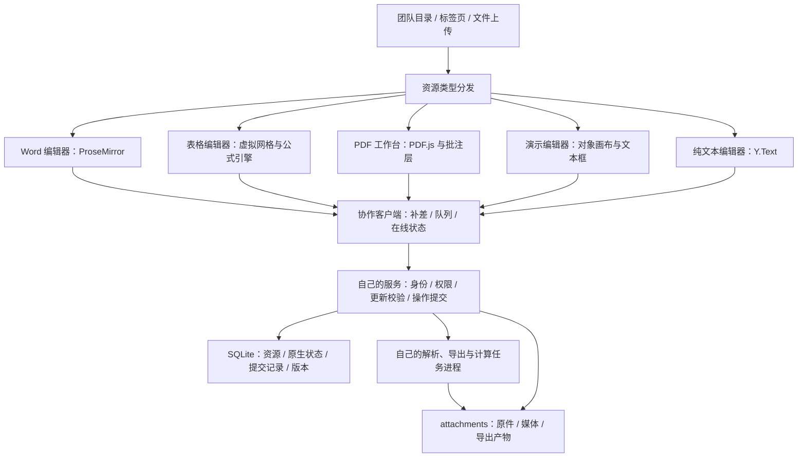

# 办公文件自主协同编辑方案

调研日期：2026-10-15。状态：首版范围已全部实施（含 2026-10-21 接入的 PDF Unicode 外观字体）；DOCX 支持段落、一级至三级标题、单层列表、网页超链接、直接及样式继承的文字格式、页面设置、含合并与多段落单元格的表格及独立图片往返，不承诺完整 Office 保真。

### 当前验收清单（2026-10-20，后续记录优先于历史进度）

当前已贯通的能力：

- **个人工作区便携备份 v2**：普通文档、回收站、文件夹、收藏、标签、集合、办公资源/协作状态、原件、媒体及命名版本进入同一 JSON；保留 v1 纯笔记读取。办公部分复用完整工作区归档的受限子进程验证，恢复只写入新个人命名空间，不创建团队或账号。普通文档重建 ID，办公 ID 在新的命名空间内保留，目录/标签/集合随恢复重映射。整包由受限子进程验证，普通文档、附件、办公状态/原件/版本、目录注册及幂等回执在服务端同一事务提交；写入失败全部回滚，提交前不显示新工作区。响应丢失后以原操作编号及源文件校验值重试，不重复创建。恢复回执存现有账户偏好记录，不污染团队备份表。
- **版本比较**：命名版本可与当前已保存快照比较，覆盖各格式文字、字符格式、结构、页面/编码设置、原件与媒体校验值及文件评论，忽略操作回执和 CRDT 事务身份。显示首处至末处变化及相邻内容，两侧各最多 1000 行，超额明确提示下载完整备份。当前为结构化内容比较，尚非原版式叠图或 Word 修订视图；同时支持原位恢复：比对当前快照 SHA-256 和代际，自动保存恢复前版本，同事务替换正文并生成新 epoch；旧窗口更新、旧语义操作及同步队列拒绝写入，旧 SQLite 原始草稿可以导出并归档后重新打开。
- **文件级评论线程**：TXT、Word、表格、PDF、演示共用讨论、回复、解决/重开、删除及重试。服务端绑定真实作者、权限、线程修订与操作编号；同线程竞争返回 409，非作者/管理员不能删除线程，通用 Yjs 上传不能伪造评论作者或回执。评论和确认回执原子保存，SSE/本地轮询显示远端更新。草稿存当前账户个人设置、纳入草稿导出；未处理草稿阻止完整备份，避免误以为其已提交。文件备份与命名版本保留讨论，恢复清空旧操作回执。每文件最多 1000 线程、10000 回复总数、每线程 100 条、每条 2000 字符及 2 MB 序列化字符配额。原生 Office/PDF 副本暂不包含这些讨论，界面明确说明。线程可关联 TXT/Word 文字选区（含跨段）、表格单元格、幻灯片对象或 PDF 批注，内容删除后显示定位失效。
- **Word 表格列操作**：以当前活动单元格对象定位列，支持左右插入列、删除当前列，保留其他单元格文字及格式；至少留一列。一次本地事务更新所有行及列数，可撤销并进入原生 DOCX 往返。每表最多 50 列、200 行、文档共 20000 单元格。被远端删除的活动单元格拒绝修改，不用旧屏幕下标定位另一列。合并单元格与单元格内多段落见下方 2026-10-20 记录；并发结构更改仍按 Yjs 结构合并，未走服务端语义协议。

- **表格任意行列结构编辑**：支持当前行列前后插入与删除，保留稳定行列身份及单元格类型；用公式语法树变换本表/跨表、相对/绝对和范围引用，删除唯一引用产生 `#REF!`。不改写字符串字面值，未知公式语法在修改之前阻止结构操作；结构与全部公式在一个事务提交。未提交单元格草稿、冲突基线、原操作编号和代际按当前账号保存到 SQLite 个人设置，刷新后显式核对重试；被删除行列的草稿可以下载或放弃。单元格格式、数字/日期格式与合并单元格见 2026-10-20 记录；任意 Excel 公式语法仍不支持。
- **PDF 标准表单和文字层**：标准 AcroForm 文本框/勾选框可在页面原位置编辑，按字段修订检查冲突；草稿保留基线与代际，重试复用原操作。读取与导出在受限进程完成，XFA/脚本表单拒绝；原件不变，普通导出更新已支持字段外观，扁平化将表单及自身支持的批注写入页面。原件附注/高亮/手绘可转为协作批注，其他原件批注按外观扁平化（见 2026-10-20 记录）；Unicode 字段或附注缺少外观字体时仍明确拒绝导出，字段协作与完整备份仍保留原文。PDF.js 增加有数量上限的文字选择层，图像与定位层在文字层失败时仍可用。
- **演示对象字段竞争与缩略图**：文本框、位置、尺寸、旋转、填充和边框分别校验对象身份及字段修订，同字段竞争保留本人输入，独立字段可分别提交。回执与正文同事务保存，修订令牌防止改回原值后的旧请求生效；启用后拒绝绕过专用接口直接覆盖既有对象字段。对象草稿及待重试操作按账号持久保存，可下载/明确放弃；对象新增/删除改为服务端语义操作（见 2026-10-20 记录）。幻灯片列表按模型显示真实缩略图并懒加载图片。
- **Word 浏览器打印预览**：预览打开时固定内容快照，按纸张、页边距和手动段前分页交给浏览器打印/另存 PDF；保留已有文字格式、表格及图片。编辑区另按浏览器排版估算自动分页（见 2026-10-20 记录），不是 Word 的排版引擎。

最新验证结果见本文末尾本轮验证记录；原有验收记录保留为历史依据。

2026-10-20 批次新增协作结构版本 12（持久导出任务表，详见 `docs/数据库迁移.md`），公共结构仍为 4；其余能力只扩展 Y.Doc 可选根（`sheetFormats`、`sheetMerges`、`pdfSource`）与账户偏好记录。

**仍需实现或需要决定：**

| 领域 | 状态 |
| --- | --- |
| PDF | 已完成（2026-10-21）：中文等表单值外观与扁平化附注使用打包的 Noto Sans SC 子集；表情符号等字体无法显示的字符明确报错并列出字符 |
| Word | 与 Word 完全一致的分页：现为按浏览器排版估算的自动分页，Word 原生排版引擎不在首版范围 |
| Word 修订 | 表格结构修改（插删行列、合并拆分）不记修订：表格结构走服务端语义操作，修订模式下照常直接生效 |

原表中的 Word 跨段选区、评论选区定位、样式继承、合并/多段单元格，表格样式/合并/日期格式、离线语义操作队列、单元格评论，PDF 原件批注编辑/扁平化、批注讨论，演示对象结构协议、母版继承、对象评论，以及持久导出任务历史、各格式成员位置、负载/断网/故障认证均已实现，见 2026-10-20 记录。完整 Office 高保真、复杂 Excel 函数、PPT 动画及任意 PDF 原文重写依旧不属于首版承诺。

### 实施进度（2026-10-15）

2026-10-23 0.1.2 收尾（补齐 10-22 记录中的未完成项）：

- **XLSX 导入跳过提示**：导入时不受支持、超出数量上限或落在工作表外的条件格式规则与图表计入 `sheetXlsx.skippedRules` / `skippedCharts`（仅在大于 0 时写入，旧导入不受影响），导入范围说明显示“原文件中有 N 条条件格式规则、M 个图表不受支持或超出范围，未导入”。
- **页眉页脚多行、图片与奇偶页不同**：每处（左/中/右）最多 5 行，对话框中按 Enter 换行；每处可放一张图片（默认缩放到 160×48 以内，上限 600×200），显示在该处文字上方，存于 `pageSettings.headerImages`（键 `scope.part.slot`，值为 Word 图片映射，与正文图片共用资源校验、备份重映射与导出）。“奇偶页不同”新增 `headerFooter.even`；编辑区按页码选择首页/偶数页/默认内容，页眉页脚高于页边距时正文下移而不被遮挡。打印用 `@page:left` 与 `@page:first` 页边框，图片以固定尺寸的 SVG 包装写入，已用 Chromium 生成 PDF 核对三页内容。DOCX 导出每行一段、图片为所在栏首行，偶数页写 `w:headerReference w:type="even"` 与 settings.xml `w:evenAndOddHeaders`；导入读取段内换行、多段、内嵌与浮动图片（同栏只取第一张，未取用的图片不进入资源），未开启 evenAndOddHeaders 时忽略偶数页页眉，与 Word 一致。LibreOffice 打开导出文件，奇数页显示图片与两行页眉，偶数页显示偶数页内容。
- **修订覆盖格式与结构**：修订模式下字符格式（加粗、倾斜、下划线、删除线、字号、颜色、突出显示、字体、上下标，含格式刷、清除格式和跨段选区）在文字片段上记 `fmt`（保存首次修改前的值，改回原值即撤销记录，作者自己插入的文字不另记）；段落格式（样式、对齐、缩进、列表、行距、段前段后、段前分页）记 `pfmt`；分段在新段落记 `insBreak`，合段（含跨段删除）在后一段记 `delBreak`，两段保持分开直到接受；插入与删除图片在图片上记 `ins`/`del`，删除自己待审的插入直接移除。审阅窗格列出“格式：加粗、字号”“段落格式：对齐”“拆分段落”“合并段落”“插入图片”“删除图片”，逐处或全部接受/拒绝（拒绝分段、接受合段时真正合并）；无标记视图隐藏段落标记与已删除图片。服务端校验新标记格式、仅正文段落可带段落修订、同一修订编号作者一致，团队文档中新修订必须属于当前成员。DOCX 导出 `w:rPrChange`、`w:pPrChange`、写在前一段 `w:pPr/w:rPr` 的段落标记 `w:ins`/`w:del` 以及包在 `w:ins`/`w:del` 中的图片，导入 Word 自己的这些标记；LibreOffice 识别导出的五类修订及作者。表格结构修改仍不记修订（见上表）。
- **端到端测试维护**：“新建文件”改为先选类型后，默认套件 267 个用例中 224 个失败；新增共用的 `newNote`/`confirmNewFile` 辅助函数，外观与标签集合入口改到“设置”，默认标题改为“未命名”，需要独立服务器的规格移到各自配置。测试存储模式下 `/api/cloud` 返回 JSON（会话为未登录），不再落到页面 HTML 而误报“团队工作空间加载失败”。办公场景改用一个共用本机账号，避免触发注册频率限制（每分钟 15 次）。
- 数据库：无表、字段或结构版本变更，只扩展 Y.Doc 可选键（`pageSettings.headerImages`、`headerFooter.even`、多行文字，段落/片段/图片上的修订标记，`sheetXlsx` 跳过计数），均纳入服务端模型校验、单文件备份与版本比较。0.1.1 及更早版本的客户端会拒绝含这些新键的文档，与以往新增可选键时一致。
- 验证：113 个测试文件、645 个测试通过（新增 `tests/office-word-structure-revision.test.ts` 7 项，另有页眉页脚与 XLSX 跳过计数用例）；63 个办公浏览器场景全部通过（新增页眉图片与奇偶页、格式与结构修订 2 个场景）；默认浏览器套件 201 项在 2 个并行进程下 199 项通过，余下 2 项单独运行通过（悬浮预览图片用例在负载下时有失败，改动前已如此）。类型检查、Web、服务端与桌面构建通过。

2026-10-22 Word 与 Excel 增强（参考 Word 插入/审阅、Excel 公式/条件格式/图表）：

- **Word 页眉页脚与页码**：插入选项卡打开对话框，页眉、页脚各分左/中/右三栏单行文字，可插入 `{页码}`、`{总页数}` 域及“第 X 页，共 Y 页”样式，可设首页不同。保存在 `pageSettings.headerFooter`（每栏最多 255 字符，不含控制字符与换行），编辑区页边显示并可点击编辑；打印时用 CSS 页边框由浏览器逐页生成页眉页脚与页码（打印预览画面中不显示）。DOCX 导出为 header/footer 部件，域写为 PAGE/NUMPAGES，首页不同写 `titlePg`；导入可读取 Word 自身的简单域与复杂域（fldChar/instrText）、制表符分栏和段落对齐，其他域保留其显示文字。
- **Word 修订**：审阅中“修订”开关存 `pageSettings.trackChanges`，团队文档中对所有成员生效。开启后输入的文字带 `ins` 标记、删除的文字保留为删除线 `del` 标记（含修订编号、作者、姓名、时间，作者一分钟内的连续编辑合并为一处）；删除自己未接受的插入直接移除，与 Word 一致。审阅窗格列出全部修订，可定位上一处/下一处、逐处或全部接受/拒绝；“无标记视图”只读显示接受后的效果。查找、字数统计跳过已删除文字，修订模式下替换也留标记。服务端校验标记格式、同一修订作者一致，团队文档中新修订必须属于当前成员，伪造他人修订被拒。DOCX 导出 `w:ins`/`w:del`（`w:delText`，含超链接内修订）与 `trackRevisions` 设置，可导入 Word 自己的修订。分段/合段、格式更改、表格与图片更改不记修订。
- **表格函数库**：公式引擎拆为核心、函数库与目录三部分，目录列出数学统计、条件统计、逻辑、查找引用、文本、日期时间、信息共 88 个函数，与实现一一对应（测试保证）。新增 `&`、`^`、`%` 运算符并按 Excel 优先级（`-2^2=4`）；条件聚合支持比较、通配符与 `~` 转义；文本函数按字符（含 emoji）截取；IFERROR 只吞可恢复错误。文本与通配符工作计入总计算预算。功能区“函数库”按分组选择，公式栏显示当前函数的参数提示并突出正在输入的参数。XLSX 导出给新函数加 `_xlfn.` 前缀，导入时去掉，引号内文本与工作表名不改写。计算版本由 2 升为 3。
- **条件格式**：比较/介于/文本包含/开头结尾/重复唯一/空值/前后 N 项（含百分比）/高于低于平均、双色与三色色阶及数据条；可快捷套用、新建、编辑、调整优先级、按选区或整表清除。规则以稳定行列身份保存在 `sheetObjects` 根，随插删行列移动或收缩，删除工作表时清理；按计算后的值求值，只影响显示。
- **图表**：插入柱形、条形、折线、饼图、面积图；单个单元格自动扩展到相邻数据块，首行/首列文字作系列名与分类，可按行或按列组织系列。图表可拖动、缩放，图表工具栏改标题、类型、图例、系列方向或删除。锚点使用稳定行列身份。
- 条件格式与图表通过 `putSheetObject`/`deleteSheetObject` 语义操作提交，以对象 JSON 修订检测竞争（返回 409），复用 `sheetOperations` 回执实现幂等重试，因此备份恢复照旧清空回执、无需额外处理。XLSX 导出写 `cfRule` + `dxfs`，图表写绘图与图表部件（含缓存值与颜色）；导入可还原本应用导出及 LibreOffice 另存的文件，不支持的规则与图表跳过、不中断导入。
- 修复：为让数据条位于文字下方，单元格输入框曾被统一设为 `z-index:1`，导致活动单元格的冲突提示被下一行输入框遮住、“重新提交”无法点击；现仅在含数据条的单元格提升输入框，并让含提示的单元格整体位于后续行之上。XLSX 导入范围说明同步更新。
- 数据库：无表、字段或结构版本变更，只扩展 Y.Doc 可选根/键（`sheetObjects`、`pageSettings.headerFooter`、`pageSettings.trackChanges`），均纳入服务端模型验证与单文件备份恢复。
- 仍未完成（已于 2026-10-23 补齐，见上方记录）：导入时跳过的条件格式/图表数量已在解析器内统计，尚未在导入范围说明中显示；页眉页脚不支持图片、多行与奇偶页不同；修订不覆盖格式与结构更改。
- 验证：111 个测试文件、627 个测试通过；57 个办公浏览器场景全部通过（含本批新增的表格增强、页眉页脚、Word 修订、团队修订 4 个场景，修复后的表格冲突场景连续多次通过）。类型检查、Web 与服务端构建通过。

2026-10-21 剩余协同缺口补齐：

- **团队 Word 表格结构改为服务端语义操作**（`/office-word-table-operation`，`office-word-table-edit.ts` 前后端共用）：插入/删除行列、合并、拆分、添加一行均提交表格身份、单元格身份与表格结构修订；修订不符返回 409 并刷新，同一操作编号重试返回原结果（回执存 `wordTableOperations`，备份恢复时清空）。修复了此前两人同时增列与增行会生成行列数不一致的表格、随后被服务端拒绝而使该成员同步卡住的问题。团队文档通用更新不得再改变既有表格的行列与合并（仍可新建/删除整张表、编辑单元格文字）；个人工作区仍在本地直接修改，保留撤销。
- **原生副本携带讨论**：DOCX 写入 Word 批注（锚定原文字范围，含跨单元格段落；回复以 commentsExtended 成线程，已解决标为完成；无定位或定位失效的放在文首）；XLSX 写入单元格批注（同格讨论与回复合并为一条，标注“[已解决]”）；PPTX 写入幻灯片批注（位于对象右上角，回复按序）；PDF 批注副本写入原生附注（挂在所讨论的批注旁，回复用 IRT，已解决写入 Review/Accepted 状态）。PDF 扁平化副本只保留页面内容，不含讨论。已用 python-docx 与 LibreOffice 打开导出文件核对作者、内容与位置。
- PDF Unicode 外观字体随后同日接入，见上方条目。

2026-10-21 PDF Unicode 外观字体：

- 新增依赖 `@pdf-lib/fontkit` 1.1.1（精确版本）。打包字体 `server/fonts/NotoSansSC-Regular.ttf`，由 Google Fonts 的可变字体实例化为 Regular（400）的静态 TrueType；许可为 SIL OFL 1.1，来源与校验值见同目录 `README.md`。
- 构建：服务端和桌面构建把 `fonts/` 复制到打包产物旁。受限解析进程没有文件权限，因此由父进程读取字体，加上 `PMF1` 头随导出任务一起传入。旧的导出任务输入没有字体头，仍可执行；数据库中的任务输入不保存字体。
- 选字规则：Helvetica 能编码的文字仍用 Helvetica，否则用 Noto Sans SC，每个文档只嵌入一次，并只嵌入用到的字形。表情符号等字体缺字的字符会报错并列出具体字符，不会输出空白字形。
- 修复 fontkit 子集化缺陷：fontkit 子集在使用短格式 loca 表时把偏移量减半，但没有把字形补齐到偶数字节。遇到奇数长度的字形，后面的字形全部错位，显示为空白或乱码。现在每个复制的字形都补齐到偶数长度，修复代码在 `office-pdf-font.ts`，没有改动 `node_modules`。测试逐个字形比对子集与原字体的轮廓边界，并验证未修复时确实会损坏。
- 解析程序大小上限由 3 MB 调整为 6 MB（fontkit 约增加 2 MB）。

2026-10-21 团队工作空间协同完善（参考 Word/WPS 协作与 Excel 共同编辑）：

- **@提及与通知**：评论输入 @ 弹出可访问此文件的成员（键盘上下选择、Enter/Tab 插入）；服务端校验被提及者为当前成员且有阅读权，不能提及自己。被提及者与讨论的既有参与者收到通知（同一消息每人最多一条）。侧栏铃铛显示未读数，点击通知打开对应空间与文件并定位到讨论；支持单条/全部已读，经事件流实时刷新。
- **在线成员**：头像、位置和“跟随”。跟随时对方移动即跳转，自己按键或点击编辑区即停止跟随。
- **Word**：远端光标（带姓名标签）与选区按字符位置绘制，随换行、缩放与分页更新；未解决的选区批注以高亮显示，页边批注按钮直接打开讨论。
- **表格**：成员选区范围以浅色显示（焦点新增可选 `end`，按稳定行列标识）；未解决的单元格批注显示右上角标记，点击打开讨论。
- **演示/PDF**：缩略图显示未解决讨论数，对象批注标记与 PDF 批注列表“查看讨论”可直达。
- **编辑记录**：标题栏“最近编辑：成员 · 时间”及编辑记录面板（10 分钟内的连续保存合并，每文件保留 200 条）。
- 数据库：协作版本 13 新增 `cloud_notifications`、`cloud_office_activity` 两表，详见 `docs/数据库迁移.md`。
- 编辑记录只统计实际改变文件的更新；客户端重新打开时补发的已知更新不计入。
- Word 表格工具改为一个浮动的“表格工具”栏（行／列／合并／表格四组），作用于当前单元格。原先行操作按钮作为聚焦行的额外单元格出现，导致该行比其他行多一列、表格错位，工具栏出现时还会把表格往下推；现在不再占用表格列，也不挤动正文。插入行或添加一行后光标进入新行；合并单元格按其首行／末行插入。
- Word 图片设置改为浮动“图片工具”栏（参考 Word 图片格式）：点击图片选中后在图片上方浮出（靠近页顶时显示在下方），不占正文流。支持宽／高（默认锁定纵横比，回车或失焦生效，方向键步进，Shift 步进 10）、四角拖动等比缩放（显示实时尺寸，按页面缩放换算）、原始大小（不超过页宽）、适应页宽、替代文字及删除；选中图片时按 Delete/Backspace 删除。

2026-10-20 Word 功能补齐（参考 WPS 文字 / Microsoft Word）：功能区扩为开始、插入、布局、审阅、视图。

- **字符格式**：新增删除线、上标/下标（互斥）、突出显示（Word 命名颜色）、字体（宋体、黑体、楷体、仿宋、微软雅黑、等线及常用西文字体，导入保留其他字体名）、清除格式（保留链接）和格式刷（复制光标处格式，应用到下一个选区，Esc 取消，可跨段）。跨段选区同样可用。
- **段落**：行距（倍数）与段前/段后间距。DOCX 导入读取 `w:strike`、`w:vertAlign`、`w:highlight`、`w:rFonts`（只取明确字体名，主题字体保持默认）及 `w:spacing`（自动行距；固定/最小行距和自动段距按默认处理），删除线随样式继承；导出按 OOXML 元素顺序写回。导出的标题样式不再自带段距，避免往返后凭空增加属性。
- **编辑与插入**：查找/替换（Ctrl+F / Ctrl+H，正文与表格单元格，区分大小写可选，替换保留首字格式，全部替换为一次撤销，最多 5000 处）、分页符（在光标处分段并另起一页，单元格内不可用）、日期、常用符号。
- **审阅/视图**：新建批注、字数统计（中日韩每字计一字，其余连续字母数字计一词，含表格）；导航窗格按标题 1–3 列出并可跳转；视图缩放与打印预览。状态栏增加字数入口。
- 无数据库变更；新增属性均在服务端 `validateWordUpdate` 校验，非法值拒绝。

2026-10-20 表格、PDF、演示界面按 WPS/Office 重构：三者与 Word 共用标题栏（应用色标、评论、导出菜单）、功能区选项卡和状态栏组件。

- **表格**：功能区分开始（剪贴板、字体、对齐与合并、数字格式与小数位、内容类型、行和列、编辑）、插入、公式（自动求和/平均值/计数/最大值/最小值、插入函数、显示公式）、数据（升序/降序、筛选、查找替换、批量粘贴、清除内容）、视图（冻结首行/首列、网格线、显示公式）；导出移入标题栏“导出”菜单。名称框可输入 A1:C3 选区，公式栏可直接编辑当前单元格并有确认/取消，fx 插入函数。网格为 Excel 式粘性行列标、绿色活动框与选区，单击行列标/左上角选中整行、整列或全表，支持拖选与 Shift 扩展。键盘：回车/Shift+回车上下移动，Tab 左右移动，方向键移动（编辑中左右键在字边界才移动），Shift+方向键扩展，Esc 取消输入，就绪状态下 Delete/Backspace 清除选区，Ctrl+B/I/U、Ctrl+C（复制为 TSV）、Ctrl+F。公式单元格未聚焦时显示计算结果。状态栏显示就绪/编辑、选区平均值/计数/求和、筛选行数和缩放。排序在含公式或合并单元格的区域会拒绝，单元格格式不随行移动；替换不改公式；筛选为本人视图，不写入文档；格式刷可复制一个单元格的格式。工作表标签和管理移至底部。
- **PDF**：功能区分开始（翻页、缩放、适合宽度/页面、旋转、选择文字与附注/高亮/手绘工具、导出）、批注、视图；左侧为按需渲染的页面缩略图（显示每页批注数）和全文查找（最多 500 页、200 处，结果定位并高亮所在文字），中间为页面，右侧为批注属性、批注列表、原件批注、在线成员与表单。状态栏可输入页码，页面区域支持 PageUp/PageDown 与左右方向键翻页。窄屏默认收起侧栏，改为单列。
- **演示**：标题栏 + 开始/放映功能区，幻灯片管理、插入对象与图片、静态放映归入对应分组。
- 修正：表单冲突提示不再遮挡操作按钮；批注坐标输入不再因小数位触发浏览器校验；滚动定位避开粘性行列标；隐藏按钮文字不再撑宽页面。没有数据库或模型变更。

2026-10-20 剩余首版能力补齐：核对代码后确认跨段连续选区、各格式评论定位此前已实现（旧表未更新），本批补齐其余各项。

- **演示对象结构协议**：新增 `addObject`/`deleteObject` 语义操作，回执按操作编号幂等，丢失响应重试返回同一对象；删除以整对象修订为基础，与他人字段修改竞争时返回 409 且不删除，被删对象的旧字段修改不能复活。通用 Yjs 更新不得增删、重排或改变对象类型/图片引用；插入图片走同一接口并核对图片归属。删除时清理该对象的字段修订记录。
- **演示母版继承**：占位符按幻灯片→版式→母版（idx 优先，再按类型）继承位置尺寸及纯色填充/边框；最近一级声明 noFill 即停止继承，主题色、文字样式和母版装饰形状仍不导入；外部版式关系拒绝。
- **Word 文字样式继承**：导入按文档默认值、段落样式 `basedOn` 链及字符样式链计算加粗/斜体/下划线/字号/RGB 颜色，粗体与斜体按切换语义叠加，直接格式优先；与正文基线一致的字号颜色不写入，标题级别已表达的字号粗体不重复写入；样式中的主题色和非法字号忽略，直接格式仍严格校验；字符样式循环拒绝。原生副本往返保持一致。
- **Word 合并与多段单元格**：模型以锚点单元格的 `colSpan`/`rowSpan` 表示合并，被覆盖单元格保持为空；单元格内用 U+2029 分隔段落，Shift+Enter 仍为换行。导入 `gridSpan`/`vMerge`，被合并单元格含文字、旧式 `hMerge`、跨列宽不一致或区域重叠时拒绝；同一单元格内段落格式不一致时拒绝而非丢弃。编辑区支持向右/向下合并（被合并内容作为新段落并入）、拆分及合并区内插删行列（删锚点行列时内容和剩余跨度交给下一格）。并发或过期的合并若会遮住文字，解析时降级为独立单元格，不隐藏内容。每格最多 100 段。
- **表格格式与合并**：新增 `sheetFormats`（加粗/斜体/下划线、RGB 文字与填充色、水平对齐、数字/日期格式码）和 `sheetMerges`，均以稳定行列标识为键，随插删行列移动；`setFormat` 每次最多 2000 格、按字段依提交顺序生效，全簿最多 5 万格、1 万个合并。合并要求除左上角外均为空，覆盖格不能写入非空内容；过期合并遮住文字时忽略。日期按 Excel 1900 序列号（含 1900-02-29）存储，日期格式单元格编辑时显示日期、输入日期保存为序列号；XLSX 导入 styles.xml（仅 RGB）、内置/自定义数字格式、mergeCells 及 1904 日期系统（转换为 1900 序列号），导出写入 styles 与 mergeCells，文本副本中日期按显示文字保存。选区支持 Shift+单击及输入 A1:C3。
- **表格离线语义操作队列**：网络不可达时，结构、批量粘贴、格式、合并与工作表操作按账户保存在 SQLite 个人设置，按创建顺序用原操作编号重放；联网、打开文件和每 15 秒自动重试，也可立即提交。每个操作仍带自身修订基础，不做乐观应用，冲突即停止后续操作，可重试、按最新结构重新提交、放弃或下载。一次只允许一个未提交的离线结构操作；若其间只有本人刚重放的操作，服务端返回的前后修订用于安全重新定基，其他成员有改动时仍返回冲突。单元格草稿在断网时标记为离线并自动重提。有离线操作时阻止文件备份并计入草稿导出。
- **PDF 原件批注**：受限进程识别原件中的附注、高亮与单笔画手绘，可一次性转为可协作批注（`pdfSource` 记录对应关系，导入幂等）；导出时以协作内容替换这些原生批注，修改和删除均生效。其他原件批注在扁平化时按外观流绘制，缺少外观时对高亮、手绘、方框、圆按几何绘制，其余类型拒绝；扁平化保留超链接。多笔画手绘、超出裁剪区等明确列为不可转换。原件识别结果按原件哈希缓存，并在表单读取之后后台加载。
- **成员位置**：Presence 增加带类型的 `focus`（Word 相对位置、单元格稳定标识、幻灯片/对象、PDF 页码），服务端校验形状及相对位置，姓名颜色仍由服务端生成。Word 在所在段落/单元格显示颜色标记，表格高亮单元格，演示标记对象和幻灯片缩略图，PDF 显示所在页；成员列表可点击跳转。本机选区直接写入 awareness，不触发编辑器重渲染；关闭页面时立即广播离开。
- **持久导出任务历史**：协作结构版本 12（见数据库迁移文档）。直接下载登记为已完成记录，可再次下载并校验 SHA-256；“导出记录”可创建后台导出，固定创建时快照，关闭页面或重启服务后继续，解析繁忙时重新排队。
- **Word 自动分页**：按纸张与页边距计算正文高度，用浏览器实际行框断页，段前分页另起一页，图片与表格行整体移动；编辑区显示分页线与“共 N 页（按浏览器排版估算）”，打印预览不含分页线。
- **负载与故障专项**：10 账号 160 次异格并发单元格提交全部成功，同格 10 方竞争恰好 1 方胜出、其余 409，重复编号幂等；演示 30 个并发对象新增、删除与修改竞争、PDF 30 个并发批注；写盘失败整体回滚且编号可复用，损坏模型的导出任务失败而后续任务照常完成。本机实测 p50 29 ms、p95 131 ms（单 SQLite、本机 HTTP、20 并发连接，MacBook 开发机），不作为生产容量承诺。
- 开发与测试中受限解析程序按输入文件修改时间缓存构建结果，修改源码后仍会重建。


2026-10-19 正文直接书写交互修正：移除“新增段落／删除段落”按钮及文字编辑节点的方框、焦点轮廓。空白 Word 文档打开后自动落光标，可直接输入；点击纸张空白处回到正文末尾，表格或图片之后点击纸张可直接续写。回车按选区换段、Shift+Enter 软换行、段首 Backspace 与段尾 Delete 合并相邻正文，方向键在正文边界前后移动。内部继续使用原有 Y.Text 模型，拆分／合并保留直接文字样式，并纳入本人的撤销／重做；不跨表格或图片误合并。空内容旧文档可直接开始书写，只读打开不建立可写内容。本次没有数据库结构变更。

2026-10-19 统一目录与办公编辑界面：取消侧栏独立“办公文件”区块。笔记及 DOCX、XLSX、PPTX、PDF、CSV、TSV、TXT 在同一文档树、文件夹、全部文档及搜索入口管理；共用重命名、移动、删除、收藏、标签与集合菜单，办公资源补充版本历史及单文件备份菜单。新建文件可指定当前文件夹，文件夹菜单支持导入办公文件；原有办公资源自动显示在统一目录，无需迁移原件或重建正文。

办公文件组织信息保存在工作区 Y.Doc 的 `officeOrganization` 根，服务端资源元数据仍为名称、类型及原件归属的唯一来源；正文存储与笔记模型保持原有标识。团队完整备份新增该根的严格字段、文件夹及标签校验，保留收藏和集合引用，旧备份缺少该根时仍可读取。本次未修改数据库表、字段或索引，公共库版本仍为 4，协作库版本仍为 11；个人物理备份通过已有工作区文档记录保存组织信息。

Word 编辑区改为“开始／插入／布局”功能区、灰底纸张、按真实纸张和页边距显示的正文画布、厘米标尺及底部缩放状态。段落与表格单元格直接显示并编辑富文本，移除逐段 textarea 和重复“格式预览”；字体与段落工具随当前选区切换。Enter 拆分段落并保留后半段文字格式，Shift+Enter 插入换行；保留中文组合输入的并发合并、相对选区、本人撤销／重做及只读权限。桌面正文区域独立滚动，移动端默认适应宽度。图片尺寸及表格行操作按聚焦上下文显示；空表格仍可添加行。

表格增加行列标题与当前单元格内容栏；演示改为左侧幻灯片列表、中央画布及右侧当前对象属性。此次完成界面与管理路径调整，未扩大 Office 格式兼容范围，也未实现 Word 精确自动分页、跨段连续选区、完整 Excel 格式或 PPT 动画等仍在方案范围外的能力。


2026-10-19 个人工作区办公入口与本地持久化：新建文件中的 DOCX、XLSX、PPTX、PDF、CSV、TSV、TXT 在个人工作区可选；办公目录接入新建、导入（TXT 保留编码预览向导）、重命名、删除、原件下载、编辑副本导出、单文件备份和命名版本。复用已实现的编辑器及格式范围，不再要求先进入团队空间。新建 PDF 为有效空白页，导入始终保留原件，编辑只修改可编辑模型。

请求通过现有 SQLite 存储认证边界进入办公引擎，不注册云账号、会话或团队空间；配置其他团队服务器时，个人办公请求与图片仍走当前 SQLite 服务。桌面版全部保存到本机 SQLite/附件目录，可不登录团队使用；网页沿用当前 SQLite 服务的部署位置，托管网页按登录账户隔离个人内容，不表示文件被存入访问者设备。资源命名空间由存储账户与个人工作区共同派生，不允许客户端指定内部命名空间；跨账户/工作区读取拒绝。办公原件与图片保持不可变，SQLite 代际变化/恢复期间拒绝旧请求，异步解析提交前重新检查工作区和账户。

正文使用同一套持久化接口，个人办公文本/段落/对象更新保存后才显示“已保存到本机”；表格/PDF 沿用语义操作接口和冲突检查。增加本机多窗口内容轮询，不发送团队 Presence；成功读取不能清除未处理的写入错误，显式重试成功才恢复保存状态。工作区删除同时清理其办公状态、附件、原件、版本和回执。团队原有同步链路保留。

个人数据库入口在 SQLiteProjectDatabase 同一启动写事务内应用现有协作迁移及完整性检查，公共版本仍为 4、办公/协作结构仍为 11，没有修改既有迁移。个人物理数据库备份扩展为包含办公元数据、模型、原件/图片和版本，恢复在同一事务替换；旧版仅笔记物理备份仍可恢复，并清除后续办公内容，旧迁移记录保持当前版本。团队账号数据库不能借此恢复为个人数据库。旧个人工作区 JSON 整包备份仍明确拒绝含办公资源的工作区，避免静默漏掉办公文件；可用本机完整数据库备份及办公单文件备份。

桌面 IPC 只放行明确的办公路由/方法，主进程使用当前 SQLite 实例；受限解析进程内嵌在桌面构建中，以 Electron 的 Node 运行模式及权限沙箱执行，不依赖用户安装 Node、Office 或第三方托管编辑服务。浏览器与真实 Electron 验证全部类型创建、导入、编辑重开、原生导出和原件下载；Electron 测试真正关闭应用并重新启动，后端测试关闭数据库和服务后重新打开，并核对原件字节及修改保持。更复杂的 Office 格式兼容仍以现有编辑器范围为准，不影响本项基础链路。

本项最终验证：97 个测试文件、540 个测试通过；27 个办公浏览器场景通过；真实 Electron 个人办公创建/受限导入导出/关闭重启测试通过。类型检查、Web/独立服务/桌面构建及差异空白检查通过，已检查桌面和 390px 个人办公截图。

2026-10-19 DOCX / PPTX 办公图片资产闭环：新增独立 Word 图片块及 PPTX 图片对象，支持 PNG / JPEG 导入、页面上传、双账户实时显示、尺寸/替代文字或几何属性编辑、删除引用与原生 Office 副本导出。图片二进制保存在既有附件存储，Yjs 模型只保存资源 ID；服务端核对图片归属，拒绝跨文件引用。办公图片与原件均不可覆盖或直接删除，删除图片块只删除当前引用，历史版本仍可恢复旧图片。文件级权限继续覆盖图片读取与上传，查看者不能插入或修改。

DOCX 仅接入独立图片段落，保留像素尺寸和替代文字；图文混排段落与表格内图片明确拒绝导入，尚不保留浮动锚点、裁切或环绕。PPTX 保留普通图片的几何尺寸、位置、旋转与对象顺序；组合内图片明确拒绝，裁切/效果与复杂组合仍未接入。外部图片、路径越界、缺失部件、非法格式/尺寸或不匹配哈希均拒绝。限制单图 5 MB、单文件引用图片合计 8 MB、1000 个图片对象、4000 万像素；PNG 校验块结构及 CRC，JPEG 校验尺寸标记。上传前在浏览器解码，加载失败显示重试；原文件仍按原字节保存。

单文件办公备份升级为版本 2，包含自包含图片字节及 SHA-256，兼容旧版本 1。命名版本、单文件恢复及完整团队备份/恢复均携带图片；恢复副本为图片重建 ID 和归属，原件、媒体、资源、协作状态及回执原子提交，失败不留下半成品引用。团队格式仍为版本 2，协作数据库仍为版本 11，无新增数据库字段或依赖。图片解析与原生导出复用受限子进程、两任务并发和超时配额；原生包复用重复图片部件，多页重复引用不重复复制字节。含媒体任务有 16 MB 打包上限，整份备份仍受 50 MB 上限约束，超限明确拒绝。

验证：95 个测试文件、533 个测试通过；26 个办公浏览器场景通过，包含双账户图片上传/显示、尺寸修改、刷新、原生副本及撤权。原生图片包往返额外由独立 python-docx / python-pptx 读取核对。类型检查、Web/服务端构建及差异空白检查通过；已检查 390px 完整图片编辑截图。专项覆盖 PNG/JPEG、PNG 损坏/截断、像素限制、外部/越界/缺失关系、重复引用部件复用、跨文件权限、不可变图片、带图历史与团队恢复、新图片 ID、缺失媒体和事务失败回滚。

本项取代下文历史记录中“图片尚未接入/演示图片拒绝备份”的阶段说明，尚未补齐完整 Office 保真、原位版本回退和下列剩余验收项。

2026-10-18 办公命名版本与安全副本恢复：TXT、DOCX、XLSX/CSV/TSV、PDF、PPTX 共用版本历史入口，提供命名保存、列表、校验下载、删除和恢复为新文件。保存前拦截未提交表格草稿、等待保存，在服务端固定模型/原件快照并隔离校验；历史不随当前文件后续编辑变化。保存操作编号按源文件及账户幂等，丢失响应重试返回原版本；更换名称需新任务，删除后的编号不会重建版本。列表、下载、恢复、删除均按源文件权限，作者或管理员才能删除，查看者只能阅读/下载。

恢复为新的资源/原件 ID 和 generation，名称带版本名；创建时复制源文件的资源级授权，模型、原件归属、恢复回执和权限同事务提交。响应丢失重试不重复创建，也不重写副本后来调整的权限。当前文件不回退，旧队列不能修改新资源；原文件的整套历史不复制到新副本。文件软删除后，所有者/管理员可从“已删除文件的版本”分页查看并恢复保存过的版本，普通成员不能借历史入口绕过删除；未保存过的内容仍需从备份恢复。

协作库增量升级至版本 11，新增 `cloud_office_versions` 与索引；单文件最多 100 个有效版本、工作区版本内容共 200 MB、含删除回执最多 10000 行。删除释放内容并保留操作编号，不自动滚动删除历史。团队完整备份格式升级为版本 2，将有效历史与正文、办公资源、附件和删除状态一起保存及恢复；旧版本 1 团队备份仍可读取。恢复前检查历史类型、归属、哈希和原件一致性，并在一个写事务内完成所有内容，失败不留半成品。版本管理者在新工作区归恢复账户，原时间保留；账号、成员、授权和旧请求回执不从备份导入。仍遵守 50 MB 整包上限，包含历史后超限时明确拒绝；单文件办公备份不携带整个历史集合。

本项交付为手动命名快照及恢复副本，并非原位回退：同一资源的 generation 切换与旧代际队列拒绝、版本差异预览、导出产物任务历史仍未完成。图片/媒体等尚未进入原模型的格式能力也不会因历史保存而自动补齐。

本批次验证：94 个测试文件、529 个测试通过（4 个测试进程），25 个办公浏览器场景通过；类型检查、Web/服务端构建及差异空白检查通过。版本专项覆盖固定快照、名称/操作编号冲突、并发及响应丢失去重、旧内容与原件下载、有效版本限额、损坏校验/清理、写入失败回滚、保存期间撤权、恢复权限继承、重试不覆盖副本权限、删除文件的管理员历史恢复、普通成员隔离、版本 2 历史全量往返、旧版本 1 兼容、历史归属/哈希拒绝及恢复中途失败整体回滚。数据库测试覆盖版本 10 到 11 升级、旧数据保留、重复启动、迁移失败回滚、高版本拒绝和包含历史 BLOB 的物理快照。浏览器覆盖持久重开、版本内容与当前内容区分、标准备份文件下载、权限、软删除历史入口、整包恢复和 390px 弹窗无溢出，已检查截图。


2026-10-18 PDF 页面批注与标准注释副本：从原件接口读取不可变 PDF，复用本地 PDF.js 渲染，接入翻页、适合宽度/固定缩放及按 90° 旋转。页面覆盖层使用 PDF.js viewport 的双向坐标转换，批注保存原 PDF 坐标；附注可单击定位，高亮可拖动矩形，手绘保存最多 1000 点的路径，亦可键盘修改坐标/高亮尺寸。底层页面内容不改写，现有原生注释不会自动导入为可编辑协作对象；文字附注以标准 Text 注释弹窗保存，尚非 FreeText 原文编辑或文本选区高亮。

增加 `/office-pdf-operation` 创建/修改/删除语义接口，稳定批注编号、服务端作者及对象修订检查；不同对象独立提交，同对象旧修订返回冲突，不静默覆盖。幂等回执与模型在同一写事务保存，响应丢失后复用编号重试；修改或删除失败保留输入，可刷新最新修订后核对重提。新建/新导入/备份恢复 PDF 启用语义协议根，通用文档更新不能绕过；历史无编号附注仍按原 Yjs 身份派生编号，首次语义操作后锁定专用接口。PDF 草稿、修订与失败操作编号存入当前账户的本机个人工作区偏好，刷新/重开可恢复，不进入团队备份。

新增 `/office-pdf-export` 固定快照，校验阅读权限后将原件及协作状态送入受限进程，以本地固定版本 `pdf-lib@1.17.1` 写入 Text / Highlight / Ink 标准批注。保留原页面内容、裁剪框、旋转和原有标准注释；中文及 emoji 使用 Unicode Contents，不用截图替代页面。输出前再次核对会话、权限及删除状态，并返回状态和原件组合快照哈希；原件不覆盖。损坏/加密 PDF、数字签名、越界页码或裁剪区域、缺少几何信息的历史高亮/笔迹明确拒绝副本导出；原件下载和原生备份仍可使用。未实现扁平化、AcroForm 协作、注释线程、原生注释编辑、PDF 文字选区层或任意原文改写。

PDF 模型继续兼容历史 `annotations` 根，增加可选 `pdfOperations` 回执根及批注几何/身份字段；备份恢复清空旧回执并初始化新协议。无数据库表/字段或迁移版本变更，协作库仍为 10。所有办公任务仍共用两个受限进程名额和 15 秒超时；PDF 副本任务使用 512 MB 堆、50 MB 输入/输出配额，普通任务保持原配额，可信解析程序包上限调整为 3 MB（加入本地 PDF 库后实测约 2.14 MB）。

本批次验证：93 个测试文件、525 个测试通过（4 个测试进程）；24 个办公浏览器场景通过。PDF 专项覆盖原内容/裁剪/旋转保留、Unicode、Highlight QuadPoints 与 InkList、原有注释保留、签名/损坏/页码/裁剪/路径拒绝、受限进程、语义 CAS 与编号冲突/重放、通用更新绕过拒绝、SQL 失败回滚、只读与导出期间撤权。双账户页面测试覆盖页面定位、响应丢失重试不重复、同对象竞争保留输入、刷新后恢复本账户草稿、最新修订重提、旋转缩放、下载原生批注副本、原件字节保持及 390px 无页面横向溢出。另用独立 pypdf 读取实际副本，核对底层原文、裁剪、旋转、Text/Highlight/Ink、中文/emoji 和几何信息。类型检查、Web/服务端构建和差异空白检查通过。


2026-10-18 完整团队工作区备份与恢复：侧栏“备份工作区”在团队空间下载自包含 `.mydoc-team.json`，不再因办公目录非空而拒绝备份。包括普通正文及目录、文件夹、标签/集合、笔记回收站、文档/白板模板、评论、全部当前已接入的办公模型、软删除办公资源及标记、不可变原件和附件字节/归属。原件与状态逐项 SHA-256 校验；缺失引用、损坏状态、非法模型或超限时明确拒绝整包，不静默遗漏。仍按各编辑器已实现模型保存，不会通过备份补回原件中尚未解析的格式特性；PPTX 图片模型当前继续拒绝，不冒充已完成图片资产支持。

“恢复备份”识别团队备份后展示来源、状态/资源/附件数量及新建位置，恢复到当前服务器的新团队工作区，当前账户成为唯一所有者。内部文档和附件 ID 在新工作区命名空间保留，目录状态键及正文/白板/模板内部引用改为新工作区，办公 generation 重建并清空旧资源语义操作回执。外部工作区引用保留原目标；外部内容不会随包复制。成员/授权、账号/会话、个人 UI、离线队列和版本历史不复制，旧本地笔记备份继续按旧流程恢复。

服务端 `/workspace-backup` 仅所有者可导出全量内容，读取固定事务快照；`/workspace-restore` 在无文件权限的受限子进程中校验再原子入库。50 MB 整包上限（含 Base64），单模型 16 MB、单附件 20 MB；最多 10000 个资源/附件、10001 份协作状态（含目录）。校验进程沿用 15 秒超时及两任务并发上限，团队任务使用 512 MB 堆、50 MB 输入输出配额；其他办公任务维持原有 256 MB/20 MB 输入限制。原件入库、归属、目录、办公资源、正文、删除状态和回执同事务提交；失败无半成品引用，文件系统允许留下无引用哈希文件。查询先检查二进制大小，客户端拦截未提交表格草稿、未完成附件上传和未确认同步状态。

协作库通过启动事务增量升级至版本 10，新增 `cloud_workspace_restores`。恢复弹窗保留操作编号；响应丢失及并发重试复用同一结果，不重复创建工作区。同编号更换文件拒绝，恢复出的工作区删除或所有权改变后拒绝旧请求重放；刷新页面或重新选文件会开始新任务。下载等待后再次核对会话、所有者权限及工作区存在性。迁移及恢复语义详见《数据库迁移》。

本批次验证：92 个测试文件、520 个测试通过（4 个测试进程）；23 个办公浏览器场景通过。新增覆盖全部办公类型/正文/附件自包含往返、内部引用及个人设置隔离、原件字节与归属、回收与软删除状态、固定快照、损坏/缺失数据拒绝、事务失败回滚、并发与响应丢失去重、删除后重放拒绝、下载等待期间撤权/会话失效、桌面代理转发，以及版本 9 到 10 的升级/保留/重启/失败回滚和物理备份。390px 恢复弹窗无横向溢出并已截图检查；类型检查、Web/独立服务构建和差异空白检查通过。


2026-10-18 XLSX 多工作表基础闭环：增加可选 `sheetOrder` 与 `workbookSheets` 原生根，工作表具有稳定 ID、名称、各表默认内容类型及独立行网格；首页继续使用旧 `sheet` 根，没有元数据的旧单表保持兼容。导入按工作簿关系顺序接入全部受支持工作表，最多 100 张、每表 1 万行/16384 列、全工作簿总计 20 万格及全局 1 万类型覆盖；任一表关系、模型、类型或配额无效时整份导入拒绝，不再只读取首表而静默丢弃其他表。原件不修改；旧版曾仅导入首表的资源不会自行解析原件补页，需重新导入原件以接入全部表。

界面新增工作表导航及新增、改名、删除、左右移动。单元格/批量/末行操作携带工作表 ID，revision 与草稿继续绑定实际 Yjs 行身份，不同表的相同地址互不串写，切换后草稿保留；服务端结构操作使用全工作簿 revision、事务和既有幂等回执，删除后的同编号重试仍能识别原结果。备份保留全部表、名称、类型及顺序，恢复清空原回执。删除表一次清理本表类型覆盖，避免按每行反复扫描全部覆盖。

跨表预览和服务端导出计算使用同一份工作簿快照，按表名解析支持范围内的引用及范围，类型解析跟随目标表；界面预览共享整本计算预算及缓存，保留每格错误码。结构确认弹窗固定原目标表，删除已提交但响应丢失时保留原操作编号和目标重试，避免回退到其他工作表后误删；浏览器已覆盖此场景。XLSX 文本副本、无缓存公式副本和可选结果缓存副本均导出全部已接入工作表；保留表名、顺序、文本类型和公式，循环、错误及不支持公式继续阻止公式副本，原文仍可选择文本副本。CSV/TSV 接口增加 `sheet` 参数，预览明确目标表；只导出该表，计算检查覆盖其可达跨表依赖，不因无关表的错误公式阻断当前表导出。快照哈希、导出前保存等待、草稿拦截、响应前权限/删除检查及受限进程保持生效。

改名/删除仍不自动改写公式 AST：若公式可能引用目标表，保守阻止操作并提示先处理公式；不支持的语法也按可能引用处理，引用检查设总源字符配额，且只扫描 AST 引用节点而不展开范围。此为保护措施，不表示已完成稳定行列 ID、插删引用转换、复制填充或删除引用的完整 `#REF!` 语义。样式、日期专用类型、合并、图片、图表、隐藏状态、共享/数组公式及完整 Excel 语义仍未接入，界面继续显示范围说明。

本项未新增数据库字段、表、结构版本或依赖。验证：91 个测试文件、511 个测试通过，类型检查通过；多表专项覆盖关系顺序、独立编辑/类型、跨表重算/循环/错误、选表 CSV/TSV、三种 XLSX 副本、原生备份、结构 CAS/幂等与删除后重试、引用保护和跨表总格子配额。另使用独立 OpenPyXL 生成真实双表输入并读取应用导出的副本，确认表名（含空格/单引号）、跨表公式及数值/文本/布尔缓存。22 个办公浏览器场景通过，覆盖双账户跨表重算、独立编辑、选表 CSV 预览、工作表增删改名排序、引用保护、全部工作表下载再导入、原件保持、只读及 390px 布局；Web/服务端构建和差异空白检查通过。此项取代下文早期“只编辑首表、CSV 与 XLSX 仅单表”的阶段限制，不表示全部剩余验收项已完成。

2026-10-18 PPTX 多页基础编辑与原生副本：兼容旧 `objects` 首页根，增加可选 `slideOrder` 稳定页 ID 顺序、`slides` 页对象及 `presentation` 画幅/首页备注；没有新增数据库字段或结构版本。可导入最多 200 页，按 `ppt/presentation.xml` 与关系文件读取顺序，保留支持的页面尺寸、文本段落、矩形/椭圆/直线的基础变换、直接 RGB 填充/边框与演讲备注；旧最小单页测试文件仍可导入。关系拒绝外部地址、重复/缺失页及歧义编号，继续遵守 ZIP/XML 和隔离进程配额。

编辑器提供页导航、新增/复制/删除/上移/下移，新增文本框、矩形、圆形（椭圆）、直线，基础位置/尺寸/旋转/颜色输入、备注及本地静态放映。页面结构走专用 `/office-presentation-operation`，整表 revision 检测竞争、同事务校验及持久化、单个操作编号回执保证重试幂等；通用文档更新不能绕过页顺序与回执检查。操作前等待当前保存完成，失败刷新最新状态；响应丢失时保留同一操作编号重试，显式选择另一页开始新的结构操作。页引用稳定，不通过删除再插入嵌套 Y 类型移动页面。对象内容仍使用既有 Y.Map 字段同步，尚未完成对象级语义 CAS 或对象评论。

新增 `format=pptx&scope=slides` 下载所有当前页的支持范围副本，复用固定快照、响应前授权/删除检查与受限导出进程；保留文本、基础形状、变换、RGB 色、画幅和备注，生成最小幻灯片、布局、母版及备注部件关系，原件不覆盖。明确提示图片/组合/主题/图表/动画/复杂样式等损失；模型中存在图片或未知类型时拒绝导出，不宣称保真往返。多页模型随办公原生备份恢复，恢复时清空原资源操作回执；任意页中的图片引用仍拒绝备份。未接入图片资产、对齐/图层工具、对象 CAS、评论、动画或完整母版/主题继承。

验证：90 个测试文件、506 个测试通过，类型检查及 Web/服务端构建通过；21 个办公浏览器场景通过。覆盖旧单页、关系顺序、多页复制排序、备注/画幅/对象往返、模型不变、结构冲突及编号去重、通用更新绕过拒绝、数据库失败回滚、查看者权限、导出固定快照及等待期间撤权/删除。双账户浏览器核对远端文本与页结构、丢失响应后的同编号重试、备注、静态放映、下载再导入、只读及 390px 无横向溢出。另用独立 python-pptx 读取生成副本，核对页数、文字、对象和备注；未宣称 Microsoft PowerPoint 像素级一致或完整 OOXML 验证。

#### 剩余验收项（尚未全部完成）

- DOCX：独立 PNG/JPEG 图片资产及往返已接入；仍缺图片环绕/裁切、图文混排/表格内图片、页眉页脚、复杂分页/表格、评论和修订、完整样式级联及格式兼容。
- XLSX：多工作表基础编辑、跨表计算及副本往返已接入；仍缺稳定行列身份/插入删除与公式引用转换、完整公式语义、格式/日期/合并/图表、导入缓存契约。
- PDF：页面坐标覆盖层、批注语义操作/冲突、高亮/手绘和标准注释 PDF 副本已接入；仍缺文本选区与多矩形高亮、FreeText、注释线程、AcroForm、扁平化和原生注释编辑。
- PPTX：普通 PNG/JPEG 图片及资产归属已接入；仍缺图片裁切/效果/组合、对齐/层级工具、对象语义 CAS、评论、完整母版主题/复杂格式；动画仍属于后续兼容范围。
- 底座：含办公资源/历史的完整团队备份、持久命名版本及副本恢复已接入；仍缺版本原位回退与旧代际队列拒绝、导出任务历史、更多编辑器的在线选区、超限任务暂存及批量草稿持久恢复。

此清单仍为未完成状态；本次完整备份与已有编辑器基础闭环不表示上述余项已完成。下文早期“PPTX 仅首张文本对象且无原生导出”的阶段限制由本项更新。

2026-10-18 表格批量粘贴：新增“批量粘贴”入口，起始位置采用当前选中单元格，可调整行列。复用严格 TSV 状态机解析制表符、换行、带引号的多行字段及转义双引号，拒绝歧义引号；剪贴板直接按字符串解析，保留字面的 BOM 字符，不套用文件编码/BOM 解码。预览显示覆盖数量和前 20 格旧值/新值，明确空字段清空目标格。首版统一按 text 类型保存，前导零、长编号和 = 开头内容不自动执行。

专用语义接口增加 `setCells`，一次最多 500 格、10 万总字符、单格 1 万字符，沿用 HTTP 256 KB 请求上限；前端额外按 UTF-8 序列化请求检查大小。限定现有行列范围，不自动扩容，不涉及插入移动或引用重写。每格携带自身 revision，在同一个数据库写事务、同一份旧状态上全部校验通过后才修改内容/类型并记录单个幂等回执；任何目标冲突、重复位置、无效类型、越界、模型配额或数据库写入失败均不产生部分结果。不使用整表 revision 阻止无关单元格的独立编辑，目标格仅类型变化仍会触发冲突。

冲突后保留输入、刷新最新状态并禁用原预览提交，要求重新生成预览后核对；网络失败保留操作编号，点击重试可恢复已提交但响应丢失的结果，不重复写入。提交前拦截未解决的单格草稿，查看者入口禁用且服务端拒绝请求。取消弹窗会放弃本次粘贴，尚未实现关闭/刷新后持久恢复批量草稿，也未实现超限批次分块暂存、格式粘贴、公式相对引用转换、矩形选区或键盘直接向网格粘贴。原件、已有备份模型、数据库结构和版本不变。

本批次验证：89 个测试文件、501 个测试通过，类型检查及 Web/服务端构建通过。新增覆盖独立单元格并行、内容/类型原子写入、幂等及编号冲突、末格竞争整批拒绝、重复/越界/配额/非法类型、数据库失败回滚、类型备份、TSV 多行/空末字段/BOM/歧义引号；20 个办公浏览器场景通过，覆盖粘贴预览、冲突保留输入、重新预览、丢失响应重试同一编号、完整多行值落库、只读拒绝及 390px 弹窗无溢出。

2026-10-18 XLSX 本表名称与公式上下文统一：导入的首张工作表名称现在同时用于界面公式预览、CSV/TSV 服务端计算结果和 XLSX 文本/公式/公式结果副本。支持以原表名限定当前表的普通引用和范围，例如 `='销售 O''Brien'!A1`；保留原公式文本，不通过字符串替换改写引用。XLSX 副本保留来源表名，不再静默改为“当前工作表”。没有来源信息的旧模型、CSV/TSV 与新建表格继续使用“当前工作表”。

计算仍只包含当前这一张表；对其他表或不存在表名的引用返回 `#REF!` 并阻止计算结果及公式副本导出，命名本表循环仍拒绝。来源表名不符合 XLSX 的 31 字符及名称字符约束时明确拒绝 XLSX 副本，可使用 CSV/TSV 或原生备份；保持旧来源信息模型兼容，不静默改名或丢失引用。继续使用原快照、隔离进程、计算配额与权限检查，原件和协作状态不变。未增加数据库结构、版本或依赖；不涉及工作表重命名/增删、多表协作、外部工作簿引用或完整 Excel 计算。本项取代下文早期“导出表名统一为当前工作表、不支持任何表名引用”的限制。

本批次全量 89 个测试文件、498 个测试通过；类型检查通过。专项验证含空格、单引号、XML 特殊字符、`__proto__` 名称、命名本表范围、循环、缺失表、默认名称兼容、非法名称拒绝、三种 XLSX 副本名称及原公式往返、CSV/TSV 结果一致与模型不变。独立 OpenPyXL 读取副本，核对表名、公式字符串和数值缓存。19 个办公浏览器场景通过，其中命名本表引用覆盖导入后界面预览、服务端 CSV 结果、勾选缓存下载再导入及原件/备份保持一致；Web/服务端构建和差异空白检查通过。

2026-10-18 XLSX 可选公式结果缓存：公式副本导出弹窗新增“写入服务端计算结果”，默认关闭，保留原有无缓存导出。勾选后使用 `scope=formula-cache-grid`，从固定的已保存快照在受限子进程内执行整表计算，直接按计算器返回的标量类型写入 `<f>` 与 `<v>`，数值、布尔 `t=b`、文本 `t=str` 分别处理，空引用与当前显示一致按数值 0 保存。文本 `001`、`TRUE`、`#DIV/0!` 不被猜测为数字、布尔或错误；空字符串仍按文本缓存。公式与缓存文本分别作 XML 转义，保留字面的 `_xNNNN_`；原公式和在线模型不修改，不使用导入原件中的陈旧缓存。

缓存导出复用全局计算预算、循环/错误/不支持公式拒绝机制、草稿拦截、保存等待及响应前权限/删除检查；响应附快照哈希与计算版本，下载名标记“公式结果副本”。仍设置打开后重新计算，因为当前基础计算器不承诺完整 Excel 语义。无缓存公式副本和全文本副本继续可用。本批次未修改数据库结构、版本或依赖。验证包含 89 个文件 495 个测试、类型检查、Web/服务端构建、独立 OpenPyXL 公式与 data_only 类型读取；缓存路径额外覆盖异步撤权、删除及原状态不变。19 个办公浏览器场景通过，覆盖可选缓存勾选、实际下载字节、默认无缓存路径、错误后文本副本降级及 390px 弹窗无横向溢出；已检查小屏截图。

本项仅补齐单表导出时的可选计算缓存，不代表原工作簿保真写回；多表、日期与完整样式、共享/数组公式、完整函数语义及原文件缓存模型仍待实现。下文早期“未实现计算缓存写回”描述指当时交付范围，现以本项可选副本导出为准。

2026-10-18 XLSX 单表公式副本：新增独立“导出 XLSX 公式副本”入口与明确确认范围，保留现有文本副本。固定快照在受限进程内先通过当前基础计算器的整表校验，再将 formula / auto 中的 = 内容写入普通 f 节点，text 始终写入共享字符串；auto 数值写入数值节点，普通非数值字符串写为文本，空自动单元格保留空格子。公式节点只做 XML 转义，不使用共享字符串的 SpreadsheetML 字面转义，避免修改公式中的 `_x000A_` 等字符串。原件和在线模型不改写。

此副本不生成公式 v 缓存，工作簿设置 fullCalcOnLoad / forceFullCalc，明确要求兼容软件打开后重算，不使用旧缓存或假值。错误、循环、不支持的公式或超过计算量时拒绝导出并提示位置；auto 数值超过 15 位有效数字、非有限或发生下溢时拒绝，允许用户改为 text 或使用文本副本，避免编号静默变为低精度数值。auto 中前导零数字按数值语义保存；需保留字面形式时选择文本。继续遵守列数、XML、ZIP、模型和受限进程配额。

接口新增 XLSX `scope=formula-grid`，同样执行草稿拦截、保存等待、固定快照及响应前授权/删除检查，下载名标记“公式副本”。当前为支持范围内的单表副本，表名统一为“当前工作表”；不支持的表引用会被当前计算器拒绝，不重写公式引用。尚不包含原工作簿其他表、样式、日期/布尔专用类型、合并、图表、批注或历史，也未实现共享/数组公式、原始工作簿保真保存和计算缓存写回。原生类型备份仍是完整协作状态载体，数据库结构、版本与依赖不变。本批次验证：89 个测试文件、494 个测试通过；19 个办公浏览器场景通过。新增覆盖公式/文本/数值节点、无伪造缓存与重算标记、公式字符串转义不被改写、导出再导入、精度/循环/错误/不支持函数拒绝、受限进程、固定快照不写回、API/界面下载和文本副本降级、小屏弹窗。另用 OpenPyXL 分别以公式与 data_only 模式读取生成文件，核对单元格类型、文本精确值和公式缓存缺省。类型检查、Web/服务端构建及差异空白检查通过。

2026-10-18 XLSX 首表关系与公式/文本导入：重写首表读取路径，在既有受限进程、ZIP 与 XML 配额校验后解析工作簿及关系，按 workbook 声明顺序选取首个 worksheet，不再依赖 ZIP 条目顺序或 sheet1 文件名。支持命名空间前缀、单/双引号属性、共享字符串、内联字符串、富文本拼接、CDATA、显式/隐式行列地址；拼音标注不拼入正文，XML 实体与 SpreadsheetML 字符转义各解码一次。保留旧最小包（缺少 workbook 部件、只有 sheetN）的兼容读取路径；真实含 workbook 的文件缺关系则明确拒绝。

普通公式保留为 = 原文并标为 formula，不再用 v 缓存替换；共享、数组及数据表公式明确拒绝，避免无法展开时产生错误编辑副本。字符串单元格保留 text，数值保留原序列字符串并使用 auto；布尔及错误值转换为明确告知的文本。选取 text/auto 中覆盖较少的一种默认类型，formula 与其余单元格写稳定类型覆盖，超出现有 1 万覆盖配额时拒绝导入。既有 1 万行、16384 列、20 万矩形格子、每格 1 万码元及 16 MB 模型限制继续执行。无效共享字符串索引、重复地址、越界地址、非有限数值、非法实体、外部首表关系、路径越界及不支持单元格类型明确拒绝。

新增可选原生 `sheetXlsx` 来源说明根，记录选定工作表名称、原工作簿表数、样式存在性和文本转换提示，纳入服务端验证与单文件备份/恢复。编辑器显示导入范围：当前仅编辑首表，样式/合并/图片/图表/超链接/日期格式尚未接入，日期序列可能仍显示为数值，布尔/错误内容按文本保留；公式使用当前基础计算器，不把旧缓存冒充重算结果。原件仍按原字节保存，原公式缓存留在原件中，尚未进入协作缓存契约。仍未完成多表、共享公式展开、样式与专用日期/数值/布尔类型，以及 XLSX 原生公式/缓存写回；数据库表、结构版本与依赖保持不变。本批次验证：89 个测试文件、492 个测试通过；18 个办公浏览器场景通过。新增覆盖工作簿关系顺序、普通公式与伪造缓存区分、共享/内联字符串、富文本排除拼音标注、命名空间/单引号/CDATA、字符单次解码、非法索引/地址/类型/实体及共享公式拒绝、失败无资源或附件引用、原件保留、类型与来源信息随备份恢复及小屏说明。另以 OpenPyXL 生成真实双表文件验证公式、文本类型和重新计算。类型检查、Web/服务端构建及差异空白检查通过。

2026-10-18 CSV/TSV 服务端计算结果导出：导出弹窗增加“服务端计算结果/公式原文”内容选择，默认结果模式。服务端从已授权固定协作快照读取单元格类型，在既有受限子进程中用一份整表计算上下文与缓存求值；文本类型不参与公式解析或自动数字转换，文本引用、前导零和普通非公式字段保留原文。使用当前基础公式规则与 JavaScript 数值精度，不代表完整 Excel 计算兼容；不读取原文件缓存值、不调用外部软件、不将派生结果写回协作模型或原件。

结果导出先做保守循环依赖检查，再计算实际公式；错误、不支持函数、无效引用或超出计算配额时拒绝生成文件，并提供单元格位置（最多前 20 处错误、前 10 处循环提示）。合法的错误样式字符串结果（例如公式返回 "#DIV/0!"）和文本中的错误字样不会误判为引擎异常。引用展开在依赖收集阶段按剩余配额提前限制，避免先构造超大依赖数组；整表共享计算预算，不让每个单元格重新获得独立预算。沿用进程并发、15 秒超时、内存和 16 MB 输出限制。

结果模式响应增加 `X-MyDoc-Calculation-Version: 1`，并保留固定快照 SHA-256、重新授权与删除检查及禁止缓存；文件名标记“计算结果”。原有 raw-text/escaped-text 接口保持原文语义，新增 raw-values/escaped-values。字段保护仍独立选择单引号前缀或保留原文，作用于最终导出字段；因此负数等结果也可能因所选保护方式增加前缀，实际预览可见。切换内容、格式或保护方式清空旧预览，下载复用生成预览时固定的相同字节；计算失败后可显式切换原文继续导出。仍未实现持久命名版本、导出任务历史、跨表完整计算、XLSX 公式/缓存原生写回，数据库结构、版本与依赖均不变。此批次取代下文“CSV/TSV 仅能导出原文、不计算结果”的阶段限制。本批次验证：88 个测试文件、488 个测试通过；17 个办公浏览器场景通过。新增覆盖整表共享预算、类型感知文本/公式结果、前导零、合法错误样式字符串、循环/错误/未知函数拒绝、隔离进程、固定快照与计算版本、计算失败不写回、原文降级、默认结果预览与下载、切换内容清空预览及小屏布局。类型检查、Web/服务端构建与差异空白检查通过。

2026-10-18 单元格文本/公式类型：新增可选 `sheetCellTypes` 原生根，保存默认类型与按稳定行相对位置、列索引绑定的覆盖项；默认类型仅支持 auto/text，单元格支持 auto/text/formula。新 CSV/TSV 导入默认 text，无需为每格写类型记录；旧表格缺少该根时继续 auto，不自动改变历史文件含义。当前仅有追加/删除末行，删除行时在同一事务清理其类型覆盖，重新添加行不继承旧类型。单表最多 1 万个类型覆盖；非法类型、失效引用、非 = 开头的 formula 内容在服务端拒绝。

`setCell` 语义操作可携带 `cellType`，内容与类型一起校验、写入和广播；类型改变也重建值项修订，确保同值类型竞争进入现有 CAS 冲突流程。操作回执签名纳入显式类型，未传类型的历史操作签名保持不变，避免旧队列重试失去幂等性。前端仅为选中单元格展示内容类型选择器，类型草稿与文字草稿一起保留、重试或选择最新内容，查看者禁用修改。formula 必须以 = 开头；auto 保留旧的公式识别及数字转换行为，text 原样保留字符串。

基础计算器和循环检测接受类型读取器：被引用的 text 单元格不会被再次解析为公式或隐式转换成数字；直接引用前导零文本保留原文，SUM/COUNT 等聚合按现有文本忽略规则处理，显式算术运算仍按现有转换规则处理。新导入的 = 内容不再显示计算结果，用户需选择 formula/auto 才参与公式求值。单文件原生备份恢复保留类型，CSV/TSV 和 XLSX 文本副本仍只保存已声明的文本内容，不携带原生类型或执行公式；XLSX 原件导入的完整单元格类型、日期/数字专用类型、完整公式缓存与原生往返仍待实施。无数据库表、结构版本或依赖变更，此更新取代下文上一批次关于“CSV/TSV 导入后仍可能自动计算”的限制。本批次验证：88 个测试文件、484 个测试通过，16 个办公浏览器场景通过；新增覆盖默认文本不求值、类型感知引用与前导零、循环检测、同值类型 CAS 冲突、回执幂等及不同类型重复编号拒绝、非法类型回滚、删行清理/新增行不继承、类型随备份恢复、双账户实时显示、刷新保留、撤权禁用和小屏布局。类型检查、Web/服务端构建和差异空白检查通过。

2026-10-18 CSV/TSV 导入向导：现有办公文件导入弹窗接入 UTF-8 / UTF-16LE / UTF-16BE 选择（自动模式按 BOM，否则 UTF-8）、逗号/制表符分隔及 CSV 式双引号/TSV 无引号两种模式。预览与受限服务端子进程复用同一严格状态机；在累积字段/行时提前限制每格 1 万 UTF-16 码元、20 万格、1 万行和原件 20 MB，非法编码、BOM 冲突、未闭合引号、字段内未转义引号及结束引号后的杂字符均拒绝。TSV 无引号模式按字面保留双引号。修正 UTF-8 BOM 与手选 UTF-16 的冲突检查；原有 TXT 导入同样受益。

首行始终保留为数据，不自动删除或识别表头；预览最多 5 行×5 列，每格 120 字符。前导零、长编号、公式样式文本、Unicode 和字段内换行按解析结果保留。完整原件按原始字节保存，不受编码选择影响。新增可选 `sheetImport` 原生设置根，记录实际编码、BOM、分隔符及引号模式，服务端校验字段和取值，单文件备份/恢复保留该设置；旧表格无此根仍兼容，无数据库表/版本变更。导出仍采用已声明的目标设置，不自动沿用导入设置。

弹窗使用顶层 Portal 与现有 Modal，支持选文件、改设置后重新预览、错误禁用提交、空表导入、只读及小屏滚动；文件读取过期结果会丢弃，避免重新选文件后显示旧内容。当前仅支持三种 UTF 编码，不提供 GBK 等其他编码、列类型转换或专用表头语义。当前网格仍可能对 = 开头内容展示基础公式计算结果，尚未完成“导入文本/主动公式”的完整单元格类型区分，界面明确说明该限制。本批次验证：87 个测试文件、481 个测试通过；15 个办公浏览器场景通过。新增覆盖三种 UTF 编码与 BOM、无 BOM 手动选择、严格/无引号 TSV、引号歧义、字段/格子/行数配额、非法设置、服务端受限进程、首行及原件一致、查看者拒绝、设置随备份恢复，以及小屏导入弹窗和 BOM 冲突禁用提交。类型检查、Web/服务端构建及差异空白检查通过。

2026-10-18 CSV/TSV 固定文本导出与预览：替换原先直接下载浏览器网格的路径。新增导出弹窗，可切换 CSV / CSV 式引号 TSV，以及“添加单引号前缀”/“保留原文”。默认对公式样式前缀（含前置空白与全角符号）和以制表符/换行开头的字段加单引号，明确提示会改变字段内容、不同软件处理方式不同，不把加引号或单引号前缀宣传为通用安全保证；需要明确文本类型时建议 XLSX 文本副本。原文选项明确提示外部软件可能执行公式样式字段。

生成预览时先检查未处理草稿、等待协作保存，再在服务端复制固定状态并复用受限子进程导出。固定 UTF-8 BOM、记录间 CRLF 和末尾 CRLF，字段内原始换行保留；按最大列宽补齐空字段，矩形区域超过 20 万格或 1 万行、导出超过 16 MB 时拒绝。预览直接解析实际导出字节，最多展示 5 行×5 列、每格 120 字符；下载复用相同字节，不再读取持续变化的网格。预览后的编辑不纳入本次下载，支持重新生成；切换格式或处理方式会清空旧预览并禁用下载。查看者可预览和下载可读文件；下载字节进入浏览器前仍执行现有异步撤权与删除检查。

当前仍为单工作表文本导出，不含其他表、样式、类型、图表、合并、批注或历史；不执行或伪造公式计算结果。错误或循环公式可作为明确选择的字面文本导出，不再因与文本下载无关的计算检查而阻止保留原文。方案中的“默认导出服务器计算结果”、导入编码/列类型预览及完整 XLSX 往返尚待实现。原件、协作模型、数据库结构/版本与依赖保持不变。本批次验证：86 个测试文件、476 个测试通过，14 个办公浏览器场景通过；覆盖服务端 CSV/TSV 两种文本方式、BOM/CRLF、Unicode、空列与字段内引号/换行、配额、受限进程、未提交草稿拦截、循环公式字面预览、预览后协作编辑不改变下载、切换选项清空旧预览、查看者下载和小屏布局。另以 Python 标准 CSV 读取器交叉核对生成的 CSV/TSV 字段。补齐新下拉框明确的无障碍名称，并将既有 TXT 行号浏览器断言改为等待动画帧后的对齐结果。类型检查、Web/服务端构建与差异空白检查通过。

2026-10-18 XLSX 单工作表文本副本：新增“导出 XLSX 文本副本”入口，确认当前网格范围和损失清单后，先检查单元格冲突草稿并等待保存，再由服务端复制固定状态，在既有受限子进程生成最小 OOXML 工作簿。副本采用共享字符串，所有单元格显式为文本；前导零、长编号、中文、emoji、首尾空白、制表符、换行、回车和公式原文保留，绝不生成可执行公式或伪造计算缓存。补齐单次 XML 实体与 SpreadsheetML 转义解码，避免共享字符串重复解码及 `_x000A_` 字面内容被误改。

副本仅代表当前模型中的单工作表，不包含原文件其他工作表、样式、类型、图表、合并、批注、历史和授权，不是完整 XLSX 往返或公式导出。公式按文本保存且不计算；原件不覆盖。工作表列数上限 16384，仍遵守现有行/格子配额、每 XML 8 MB、XML 元素数量、进程内存/超时与输出上限，超限明确拒绝。导出响应携带快照 SHA-256、禁止缓存；下载前再次检查登录账户、资源访问与删除状态，查看者可下载可读文件。数据库结构、版本与依赖不变。本批次验证：86 个测试文件、474 个测试通过，13 个办公浏览器场景通过；新增覆盖冲突草稿阻止导出、只读下载、前导零/长编号/公式原文、转义往返、列与 XML 配额、固定快照及异步撤权/删除。使用独立 OpenPyXL 打开生成文件，核对工作簿结构、文本值和单元格类型；小屏导出弹窗截图无溢出。类型检查、Web/服务端构建和差异空白检查通过。

2026-10-18 办公恢复幂等提交：协作库追加版本 9，新增 `cloud_office_restores`，以工作区、用户和 UUID v4 恢复编号隔离请求；记录上传原始字节的 SHA-256 和新资源 ID，与原件归属、协作状态及资源在同一写事务提交。并发或服务重启后，同一编号及相同字节返回原文件的当前元数据；相同编号搭配不同字节返回 409，已删除文件返回 410，始终重新检查工作区写入权限与资源访问权限。回执随工作区删除，整库快照保留，单文件备份不携带。接口为旧调用方保留未传编号时每次新建的行为。

恢复弹窗为每次文件选择生成编号，失败后点击重试复用该编号，避免服务端已提交但响应丢失时重复创建。重新选择文件或重新打开弹窗会开始新任务；尚不支持浏览器刷新后恢复未完成的任务。服务端回归覆盖并发去重、编号与内容冲突、跨用户/空间隔离、撤权及删除后重试、回执写入失败回滚；数据库测试覆盖版本 8 升级、数据保留、重复启动、失败回滚及整库快照。本批次验证：85 个测试文件、470 个测试通过；12 个办公浏览器场景通过，其中模拟服务端提交后响应丢失，再次点击恢复仍只有一个新文件。类型检查、Web/服务端构建及差异空白检查通过。此更新取代下文上一批次“暂不具备任务编号幂等性”的限制。

2026-10-18 单个办公文件备份/恢复：新增独立 `mydoc-office-resource` v1 JSON 格式，包含资源名称/格式/模型版本、固定协作快照、可选不可变原件及两者的 SHA-256。支持当前 TXT、DOCX、XLSX/CSV/TSV、PDF 批注和 PPTX 文本对象模型，不代表格式兼容范围之外的原生编辑能力。单包上限 50 MB，状态 16 MB、原件 20 MB；严格校验字段集合、Base64、字节数、校验值、格式/模型版本及 PDF 原件。校验值用于检测字节损坏，不是签名或来源认证。导出在数据库事务中复制固定状态和原件，随后在既有受限子进程中验证模型；响应前重新检查账户、资源访问与删除状态。

恢复使用同一受限进程验证 Yjs 模型及依赖完整性，拒绝未知根、非法结构和尚未纳入归属契约的演示图片引用；表格的旧提交回执清空，正文与网格对象身份保留在新文档中。生成新的资源 ID、原件引用 ID 和恢复代际，在同一写事务中写入资源、附件引用/归属与协作状态；嵌套附件事务使用 SQLite 保存点，失败时全部引用回滚，允许仅留下未引用的不可变哈希文件。新文件不覆盖旧文件、不继承源工作区成员或单独授权，按目标工作区默认权限可见。关闭/取消或验证期间失去权限不会写入资源。

团队办公目录增加每个文件的“备份”按钮和“从备份恢复办公文件”入口，查看者可备份可读资源，工作区只读时不能恢复；同时修正文档授权检查，工作区查看者也必须遵守单独的 denied 授权。导出前等待当前文件保存；有未处理表格草稿时阻止备份，提示先完成处理。恢复成功直接登记服务端返回的新资源并打开，避免目录刷新失败诱发重复恢复。当前是单文件备份，不包含笔记目录、跨资源媒体、历史版本、在线状态或授权；旧完整工作区备份/草稿格式仍保留拒绝含办公资源的保护，完整工作区 v2 恢复契约仍待实施。恢复请求暂不具备任务编号幂等性，重复恢复会明确生成多个新文件。此批次没有数据库结构、版本或依赖变更。 本批次验证：全量 85 个测试文件、469 个测试通过；12 个办公浏览器场景通过。测试覆盖五类模型备份/恢复、TXT 编码设置与原件字节一致、跨空间新身份、损坏/未来版本/非法模型拒绝、事务故障回滚、查看者与 denied 权限、桌面代理头部与请求体转发、表格冲突草稿阻止备份及小屏恢复弹窗。恢复弹窗通过 Portal 挂在页面顶层，侧栏折叠和窗口缩放不会隐藏已打开的弹窗。类型检查、Web 与服务端构建和差异空白检查通过。

2026-10-17 TXT 在线会话与行级选区：复用现有 Yjs Awareness 和 `/presence`，文本编辑器在聚焦后以 120 ms 合并窗口发布相对选区；成员列表显示其他会话的名字、颜色和逻辑行列范围，可点击定位。最多显示 32 个会话，同一行侧栏最多显示 3 个颜色标记；自动折行或组合输入期间不绘制侧栏标记，仍可查看成员位置。当前交付是行级标记与位置列表，尚非文本上逐字符的覆盖光标/选区高亮。选区保持功能同时覆盖本人的远端前插/删除场景，远端更新后在布局阶段恢复相对锚点；无效或指向其他根的远端选区只显示“正在查看”。

新增授权的 Presence 快照 GET，解决复用工作区 SSE 连接后再打开文件时缺失既有在线状态。广播及 SSE 初始重放按文档订阅、当前资源存在性与文档授权过滤，姓名/颜色始终由服务端生成，禁止借客户端字段伪装其他成员；同一 client ID 的跨账户占用返回冲突。Presence 存储绑定会话，注销、文档授权变化、资源删除和成员断开时清理；计时器检查 30 秒过期、会话与权限失效，最长按既有 15 秒清扫周期收敛。服务实例最多保留 1 万条临时状态，单次请求沿用 8 KB 限制，不落库、不写入原件或 Yjs 正文。前端关闭最后一个文本视图或页面隐藏时停止活跃状态，同一文档分屏按视图引用计数，选区更新失败不阻塞正文同步。仍未实现跨设备会话去重、图形光标覆盖层或其他 Office 编辑器的专用 Presence；完整办公备份及其他阶段继续推进。数据库结构、版本与依赖不变。 本批次全量 85 个测试文件、467 个测试通过，11 个办公浏览器场景通过，并补跑视图关闭/重开、模拟页面隐藏/恢复通知和撤权清理场景。专项测试覆盖其他根/非法选区、回放与广播隔离、在线快照、冒用身份拒绝、状态过期、注销及只读状态；移动端截图确认行标记和成员列表无横向溢出。类型检查、Web 与服务端构建及差异空白检查通过。

2026-10-16 TXT 逻辑行号与位置状态：TextDocumentEditor 增加 TextLineGutter 侧栏和位置状态栏，显示逻辑行、当前列、总行数及选中字符数；空文件计为一行，末尾 LF 保留最终空行。行号按内部 LF 分隔；列和选中字符按 Unicode 码点计数，代理对 emoji 计为一个字符，组合标记分别计数，制表符计一列，不宣称字素簇或视觉字符宽度。反向选区按活动端显示位置，程序化查找定位及远端文本刷新会更新状态。

默认使用不自动折行视图，正文水平滚动限制在文本框内；格式面板增加本机“自动换行”和“显示行号”选项，只读成员同样可调整。自动折行时隐藏侧栏行号，底部仍显示逻辑行列；关闭自动折行后恢复先前行号开关。视图选项只保存在当前组件会话，不同步或写入协同文档，也不影响导出换行设置。行起点用 Uint32Array 缓存，光标定位二分检索；侧栏仅渲染可见行及少量缓冲，通过滚动与 ResizeObserver 同步实际行高、内边距和视口，避免百万空行创建百万个节点。原件、数据库结构、版本与依赖均未改变。协作光标、Presence 扩展、完整办公备份及其他未交付项仍按方案继续实施。 本批次验证：全量 85 个测试文件、465 个测试通过，10 个办公浏览器场景通过。新增覆盖千行文本滚动和侧栏行高对齐、虚拟节点数量、远端换行更新、emoji/反向选区位置、空文件/末尾空行、本机折行开关及只读视图设置；移动端长行截图确认整页无横向溢出。类型检查、Web 与服务端构建和差异空白检查通过。

2026-10-16 TXT 查找替换：文本编辑器新增可折叠面板及正文 Ctrl/Cmd+F、Ctrl/Cmd+H 入口，提供区分大小写的字面查找、非重叠匹配计数、上一处/下一处循环定位、替换当前项和全部替换。查找与替换字段支持换行、制表符、中文和 emoji；正则符号及 `$&` 等按字面处理，不解释为正则或替换模板。空查询不匹配，每次最多收集 1 万处匹配，超过时提示缩小查找范围并阻止全部替换；替换前检查 Unicode 代理字符和最终 100 万 UTF-16 码元限制，失败不写入。

当前匹配以 Yjs 相对位置及预期文字保存：远端前插后仍定位原文字，内部内容变化或被删除后旧匹配失效，需重新查找。全部替换只对当前快照匹配从后向前修改，在一个 LOCAL_ORIGIN 事务提交，前后切断 UndoManager 捕获批次，一次撤销仅恢复本次替换，不撤销远端操作。只读成员仍可查找，替换每次重查写权限；正文输入法组合期间暂停定位和替换，不介入组合草稿。面板小屏换行并限制高度，正文保留原编辑器与编码/换行设置。此批次不改变原件、数据库结构、版本或依赖。暂未实现正则、忽略大小写、整词、选区范围替换、跨资源查找、行号或协作光标；TXT 首期仍有未交付项。 本批次验证：全量 85 个测试文件、462 个测试通过，9 个办公浏览器场景通过；新增覆盖双人远端前插定位、匹配失效、字面美元替换、批量替换一次撤销/重做、输入法禁用、撤权与移动端无溢出。类型检查、Web 和服务端构建及差异空白检查通过。办公浏览器测试仅复用认证会话，每场景仍创建独立工作区，避免反复注册触发真实认证限流；生产限流保持不变。

2026-10-16 DOCX 自定义表格尺寸与指定位置插行：新建入口改为行列数弹窗，支持 1–200 行、1–50 列，默认 2×2，显示单元格总数并明确追加到文档末尾、列数固定；无效输入及只读时禁用提交，保存前再次检查权限与最新配额。每行增加“上方插入”“下方插入”，按目标行 Yjs 对象在当前表格中的身份重新解析位置，不保存易失效的数字行号；目标行或整张表格已删除时明确拒绝。插入的新行独立创建空 Y.Text，原行的文字、格式、链接与选区继续归属原对象。并发在同一行前插入按 Yjs 序列顺序合并，不复制或重建原行。

前端新建和新增行现统一检查每篇 100 个表格、2 万个单元格及每表 200 行配额；单表已满时禁用插行按钮。服务端仍逐次验证最终模型，边界并发可能超出配额并被拒绝，尚非服务端结构语义仲裁。原件、协同模型结构、数据库版本与依赖保持不变，旧的零行表格仍可通过追加一行恢复；新建弹窗不创建零行表格。仍未实现增删列、合并/拆分、多段落单元格、原始列宽/复杂样式保真或 ProseMirror Word schema。 本批次全量 85 个测试文件、458 个测试通过，8 个办公浏览器场景通过；新增覆盖自定义尺寸校验、双人指定行前后插入、原行格式保持、并发插行收敛、目标删除拒绝、配额失败不变更状态、弹窗撤权与移动端无溢出。类型检查、Web 和服务端构建及差异空白检查通过。

2026-10-16 DOCX 单元格格式编辑：每个单元格增加“设置格式”入口，弹窗复用抽出的 WordParagraphEditor，支持文字选区加粗/斜体/下划线、字号与 RGB/自动色、网页链接，以及单元格内段落标题、列表、对齐和左右/特殊缩进；网格保留紧凑文字输入与格式预览。修改实时进入同一单元格 Y.Text，不重建表格或复制正文。单元格界面不提供段前分页或删除段落，原有导入属性仍保留。旧纯段落和既有表格模型兼容，无数据库结构、版本或依赖变更。

格式函数现在验证正文或单元格在当前对象树中的有效归属，按表格/行/单元格对象身份校验；删除行或整张表后拒绝旧选区及段落格式写入。字符选区沿用 Yjs 相对位置，远端前插后仍作用于原文字；每次编辑重查工作空间写权限，只读模式可打开面板查看，控件禁用。选区缺失或混合格式、组合输入、格式错误、远端更新与小屏弹窗沿用正文已有行为。单元格新设列表建立独立分组，不自动连接相邻单元格列表；原导入分组继续保留。当前仍为输入框加格式预览，尚未实现 ProseMirror Word schema、单元格多段落、合并/拆分、增删列、精确分页或原始表格样式保真。 本批次全量 85 个测试文件、455 个测试通过；既有 7 个办公浏览器场景及新增单元格格式场景均已通过。新增测试覆盖远端前插后的选区格式、嵌套链接弹窗、格式导出、在线撤权、删行关闭面板和移动端弹窗溢出。类型检查、Web 与服务端构建及差异空白检查通过。

2026-10-16 DOCX 基础矩形表格：原有 paragraphs 根保持兼容，元素扩展为正文 Y.Text 或表格 Y.Map（kind、固定 columns、rows）；每行是 Y.Array，每个单元格是独立 Y.Text。导入按原顺序读取段落与表格，支持每格一个段落及已有字符格式、标题、列表和链接；新建入口提供 2×2 表格，支持单元格文字协作、追加行、按行对象删除和删除表格。组件结构为 WordEditor → WordTableEditor → WordTableCell，沿用已有控件及字符级差量，组合输入使用嵌套文字快照与相对位置。行操作按对象身份解析位置，远端插入不会使删除操作落到另一行。服务端校验完整矩形、根结构与嵌套类型，限制每篇 100 个表格、每表 200 行/50 列、合计 2 万单元格；并发删除允许留下零行表格，可添加一行恢复，导出则明确提示先恢复或删除，不补造内容。

导出固定服务端快照中的正文与表格，生成 tbl/tblGrid/tr/tc 结构、等宽列和基础网格边框，可重新导入；结构依据 [Microsoft WordprocessingML 表格文档](https://learn.microsoft.com/en-us/office/open-xml/word/working-with-wordprocessingml-tables)。原件、数据库结构与版本不变。合并单元格、嵌套表格、缺格及多段落单元格明确拒绝导入；本批次未保留原始列宽、表格样式、复杂边框和行高，未提供单元格格式工具栏、增删列、排序、合并/拆分或逐页布局。结构变更沿用 Yjs 序列合并，尚未实现服务端语义操作仲裁；配额边界并发仍可能被服务端拒绝。测试覆盖顺序往返、中文/emoji/格式链接、结构校验、同格文字合并、并发加删行与已删对象保护，浏览器覆盖双人编辑、行操作、只读撤权、下载和移动端溢出。完整富文本编辑器、图片及其他未交付项继续按下述方案推进。 本批次验证：全量 85 个测试文件、453 个测试通过；7 个办公浏览器场景通过，并补跑表格后正文列表回归。类型检查、Web 与服务端构建通过，python-docx 独立验证原生表格导入及副本重开；移动端截图确认整页无横向溢出。

2026-10-16 DOCX 直接字号与文字颜色：字符属性增加 fontSize（1–200 磅、半磅步进）及 color（六位 RGB 或 auto）。导入读取 run 的 w:sz/w:color；导出按 OOXML 属性顺序写入半磅字号和颜色，保留已有加粗、斜体、下划线及网页链接。字号单位参考 [Microsoft FontSize 文档](https://learn.microsoft.com/en-us/dotnet/api/documentformat.openxml.wordprocessing.fontsize?view=openxml-3.0.1)。工具栏支持常用字号、自定义字号弹窗、RGB 色板/自定义颜色及自动色；只作用于相对选区，混合选区显示“混合”，恢复继承只移除指定属性。服务端拒绝越界/非半磅字号、CSS 字符串及错误属性类型；不接收任意 CSS。预览显示直接字号和颜色，大字号可在预览区域横向滚动，避免整页溢出；只读与组合输入期间禁用操作。原件及数据库结构不变。仅支持直接非复杂文字字号和显式 RGB/auto，暂不处理字体族、szCs、主题颜色、完整字符/段落样式字号颜色级联；直接主题色会明确拒绝导入。表格、图片、自动分页及完整富文本编辑器仍待实现。

2026-10-16 DOCX 整篇页面设置与段前分页：增加可选 pageSettings Y.Map 根，其中 layout 以一个原子对象保存纸张宽高及四边页边距（twips）；旧模型缺省使用 A4 纵向、四边 72 磅。尺寸范围 1–22 英寸，单边距最多 360 磅，要求保留至少 18 磅正文宽高；服务端拒绝未知字段、隐藏根序列、缺失依赖及非法范围。页面弹窗支持 A4/Letter、横纵方向、四边页边距，保留合法自定义导入尺寸；如已收到远端页面修改，旧草稿保存会保留草稿并提示重新载入。整套设置并发时遵循 Yjs 原子值竞争收敛，不承诺服务端 CAS 或逐字段合并。段落增加 pageBreakBefore 布尔属性，支持样式继承、显式开关及导出标记；界面显示分页要求而不生成自动页码。导入/导出识别单个正文末尾 sectPr、pgSz/pgMar 和段前分页，依据 [Microsoft PageMargin 文档](https://learn.microsoft.com/en-us/dotnet/api/documentformat.openxml.wordprocessing.pagemargin?view=openxml-3.0.1)。遇到多分节、段内分页、装订线、多栏或方向尺寸矛盾会明确拒绝。原件及数据库表结构不变。尚未实现 Word 精确分页、打印预览、页眉页脚、镜像页边距、动态页码、多分节和段内分页符；表格、图片和完整富文本编辑器仍待实现。

2026-10-16 DOCX 右缩进和特殊缩进：新增 `rightIndent`（0–2880 twips）和有符号 `firstLineIndent`（-2880–2880 twips），正值表示首行、负值表示悬挂、零表示无特殊缩进；模式与数值在同一属性中更新，避免并发产生矛盾模式。导入读取 w:right/w:firstLine/w:hanging，并沿用段落样式继承；同时声明首行/悬挂时悬挂优先，直接零值可覆盖继承。导出生成合并的 w:ind，只写入一个特殊缩进模式。依据 [Microsoft Indentation 文档](https://learn.microsoft.com/en-us/dotnet/api/documentformat.openxml.wordprocessing.indentation?view=openxml-3.0.1)。界面增加右缩进与特殊缩进选择，保留导入的合法非标准值，支持只读/组合输入禁用。预览为流式近似：用响应式内边距限制左右缩进，悬挂时预留可见空间，避免小屏文本越界；导出保留精确 twips 值。服务端校验整型、范围和属性类型，原件及数据库结构不变。暂不处理字符单位、负左右缩进、双向/start-end、镜像页边距、编号定义中的缩进继承及精确分页；含字符单位的缩进会明确拒绝导入。表格、图片、页面设置和完整富文本编辑器仍待实现。

2026-10-16 DOCX 段落基础布局：增加可选 `align` 和 `leftIndent` 段落属性。支持左/中/右/两端对齐及 0–2880 twips（0–144 磅）左缩进，旧模型缺省按左对齐、无额外缩进显示；界面提供常用值并保留导入的非标准合法值。导入读取直接 w:jc/w:ind（仅 w:left）以及段落样式 basedOn 继承和默认段落样式；直接零缩进/左对齐可覆盖继承值。导出按规范顺序写入段落属性，保留已有标题、单层列表、网页链接和直接文字样式。结构参考 [Microsoft Indentation 文档](https://learn.microsoft.com/en-us/dotnet/api/documentformat.openxml.wordprocessing.indentation?view=openxml-3.0.1)。前端以独立 Yjs 属性事务调整，服务端拒绝未知对齐、非整数/负数/超限缩进。只读与组合输入期间禁用操作，预览用响应式内边距表示缩进；窄屏缩进最多占预览宽度 40%，导出仍保留实际值。数据库结构不变。当前不处理右缩进、首行/悬挂缩进、字符单位缩进、双向文字/start-end 对齐、编号定义中的缩进继承或 docDefaults 布局；这些不在本次兼容副本保真范围。完整分页、表格和图片仍待实现。

2026-10-16 DOCX 外部网页链接：增加字符串字符属性 `href`，导入保留 hyperlink 内的文字顺序与直接格式，通过 word/_rels/document.xml.rels 解析外部目标；导出为网址去重后生成本地关系 ID、External 关系及 hyperlink 节点，目标做 XML 转义。结构依据 [Microsoft Hyperlink 文档](https://learn.microsoft.com/en-us/dotnet/api/documentformat.openxml.wordprocessing.hyperlink?view=openxml-3.0.1)。共用地址校验仅允许无账号密码的 HTTP/HTTPS 绝对网址，限制 2048 字符，拒绝控制符、反斜杠和无效地址；服务端同样校验通用更新。限制唯一链接 9998 条、关系 XML 8 MB、导入关系 1 万条，拒绝关系编号重复或缺失。编辑器增加设置/移除链接和网址弹窗，以相对位置保存选区；弹窗期间远端编辑后按当前有效选区提交，选区删除或撤权后拒绝修改。预览只渲染合法网页链接，使用新窗口及 noopener/noreferrer；导入和导出不请求目标网址。暂无书签、内部链接、邮件链接及域代码支持：含这些结构的正文导入会明确拒绝，原件不会被写入半成品。数据库结构不变，旧模型仍兼容；表格、图片、分页和完整富文本编辑器仍待实现。

2026-10-16 DOCX 单层列表：段落增加可选原子 `list: {kind, id, start}` 属性，支持圆点项目符号和十进制编号。编辑器提供无列表/项目符号/编号切换，加入相邻同类列表时复用分组，按分组及文档顺序派生预览编号；标记不写入正文字符串。列表类型、分组和起始值在一个属性中更新，独立于标题和字符格式；只读和组合输入期间禁用操作。服务端校验属性结构、分组一致性和定义数量，拒绝任意格式注入。导入读取 numbering.xml 的 abstractNum/num、一级起始值覆盖及段落样式继承；显式 numId=0 可取消列表。引用缺失、不支持的编号模式、层级格式覆盖及实际多级列表会明确拒绝导入。导出生成 numbering.xml、内容类型及正文关系，保留分组、起始编号、空项、标题和直接文字格式。编号引用结构参考 [Microsoft NumberingId 文档](https://learn.microsoft.com/en-us/dotnet/api/documentformat.openxml.wordprocessing.numberingid?view=openxml-3.0.1)。原件及数据库结构不变。当前仅支持圆点和 `%1.` 十进制单层模式，不支持多级/罗马/字母编号、图片项目符号、任意编号模板与完整源缩进；暂未提供指定起始值、重新编号或列表分组调整界面，导入的起始值会保留。完整富文本编辑器、表格、图片、分页及备份恢复仍待实现。

2026-10-16 DOCX 标题：段落 Y.Text 增加可选 `heading: 0|1|2|3` 属性，旧文档缺省视为正文；新增段落类型选择及预览，支持正文和一级至三级标题协同切换。标题、字符和直接文字样式分别修改，不重建段落。导入识别直接 `w:outlineLvl`、常规 `word/styles.xml` 中段落样式的标题大纲级别及 `basedOn` 继承；显式正文级别覆盖样式，常见 Heading1–3 缺失定义时按内置语义处理。样式上限 1 万、继承最多 64 层，拒绝循环、重复编号和无效大纲值。服务端只允许 0–3 的整数标题属性。导出补齐 styles.xml、内容类型和正文到样式部件关系，为标题生成样式及大纲级别，保留空标题和直接字符属性。大纲值依据 [Microsoft OutlineLevel 文档](https://learn.microsoft.com/en-us/dotnet/api/documentformat.openxml.wordprocessing.outlinelevel?view=openxml-3.0.1)。此批次无数据库结构变更。仅继承标题级别，不承诺源样式字体、主题、间距或完整样式级联；四至九级标题及其他未知样式仍按兼容副本范围处理。列表、表格、图片、分页、完整富文本编辑器和备份恢复仍未实现。

2026-10-16 DOCX 直接文字样式：在现有 `paragraphs: Y.Array<Y.Text>` 上增加 `bold`、`italic`、`underline` 布尔字符属性，旧纯文本模型保持兼容，无数据库结构变更。导入读取正文 run 的直接加粗、斜体及单下划线（包括显式关闭），导出按字符片段生成 `w:rPr`；结构依据 [Microsoft RunProperties 文档](https://learn.microsoft.com/en-us/dotnet/api/documentformat.openxml.wordprocessing.runproperties?view=openxml-3.0.1)。服务端逐片段校验，拒绝非字符串嵌入、未知或非布尔字符属性、段落隐藏属性，并限制总格式片段数 20 万。界面保留文字输入框，新增选区样式按钮和独立格式预览，选区以 Yjs 相对位置跟随远端更新，组合输入期间和只读时禁用格式操作。验证覆盖三种样式混排、显式关闭、导出重开、并发文字/格式收敛、远端前插后的选区、emoji 边界和撤权。独立 python-docx 重开验证了三种直接样式及显式取消加粗。仅处理正文 run 的这些直接属性，不解析 styles.xml/主题/段落样式继承、复杂文字样式、其他下划线类型；标题、列表、表格、图片、分页及评论仍未实现。预览不是 Word 分页排版，编辑区本身仍为纯文本输入。

2026-10-16 DOCX 正文兼容副本导出：编辑器增加明确范围确认，等待当前保存队列完成后请求服务端快照。服务端单次读取资源及 Yjs 状态，复制固定快照并返回 SHA-256 标识，在已有受限子进程内生成 DOCX；返回前重查会话、资源访问权限与删除状态。允许查看者导出，拒绝缺少范围确认、撤权、已删除和非 Word 资源。生成最小 OOXML 包，支持普通段落、空段落、空白、制表符和换行；拒绝富文本、嵌入、非法 XML 字符及超过 8 MB 的正文 XML。导入器同时补齐空段落、制表符、换行及数值字符引用读取，支持正文往返。格式结构参考 [Microsoft Open XML 文档](https://learn.microsoft.com/en-us/office/open-xml/word/how-to-create-a-word-processing-document-by-providing-a-file-name)。原件和数据库结构均不变。这不是原件保真导出：样式、图片、表格、页眉页脚、评论和修订尚未纳入模型；完整分页、持久版本与导出任务队列仍待实现。快照哈希仅标识本次输入，不是持久版本号。Yjs 对未配对 UTF-16 代理字符的既有序列化替换行为不由此导出恢复。

2026-10-16 独立解析进程：DOCX/XLSX/PPTX/CSV/TSV 解析和初始模型校验移到独立 Node 子进程。每个服务实例最多同时执行 2 个任务，准备及执行共用 15 秒超时，V8 老生代堆预算 256 MB，输出模型上限 16 MB；超时、取消、输出超限、崩溃和服务关闭都会终止受管进程并释放名额。子进程不继承服务端环境变量，不授予文件系统、派生进程或 worker 权限；可信解析代码和原件经有界二进制管道传输，不通过 shell 拼接，不在临时文件中落原件。生产构建将解析程序嵌入服务端产物，开发/测试按当前源码打包。主进程接收解析结果后重查会话、空间写权限和请求取消状态，再保存附件与资源；新增撤权测试确认等待期间服务可响应且拒绝后没有数据写入。PDF 当前仅创建空批注模型，TXT 保留已有有界文本导入路径。本批次无数据库结构及依赖变更。Node 权限及 V8 堆预算不是完整 OS 沙箱或 RSS 硬限制；内核级出网隔离、容器资源限制、持久任务队列及崩溃重试仍待后续。

2026-10-16 导入边界加固：DOCX/XLSX/PPTX 使用统一受限解包入口，预检中央目录和本地头；限制 2048 条目、64 MB 总展开量、16 MB 单件及 8 MB XML 部件。拒绝危险/重复路径、加密、分卷、超大 ZIP64 声明、不支持的压缩、头部不一致、重叠数据和 CRC 错误；按小块解压并检查实际展开大小。XML 严格解码 UTF、核对声明编码，禁止 DTD/实体声明，并检查嵌套深度、元素数量和基本标签结构。解析及初始协作模型校验均先于附件引用写入和资源写事务；非法导入测试确认资源、附件、归属和协作状态计数不变。此批次无数据库结构和依赖变更。这里仍是进程内配额检查，独立解析进程、CPU/超时隔离及完整 OOXML schema 校验尚未完成。

2026-10-16 表格语义提交：新增 `/office-sheet-operation`，单元格携带 Yjs 对象身份与基础值组成的版本标记，服务端在写事务内验证、修改状态和记录操作编号；不同单元格独立确认，同格旧版本返回 409，重复操作编号且内容一致时幂等返回，变更内容的重用被拒绝。新增行/删除末行使用完整状态向量检查。表格通用 `/document POST` 关闭，客户端对服务端管理表格只接收补差，不再上传补差中的删除集。前端输入在失焦或 Enter 后在线提交，确认前不进入共享状态；冲突展示本人草稿及最新值，并提供显式重提/使用最新内容。网络失败重试沿用原操作编号；草稿保留在当前工作区实例并纳入草稿导出，尚不承诺刷新页面后的离线恢复。存在未处理草稿时禁止本地结构操作和常规 CSV/TSV 导出。幂等记录保存在 Yjs 的 `sheetOperations` 可选根，首版每表上限 1 万次确认操作；未改变数据库表结构。完整稳定行列模型、批量粘贴、操作历史压缩、多表、可靠离线队列仍未完成。

2026-10-16 公式计算修正：替换正则拆分计算为词法分析和 AST 解析，按运算优先级及左结合规则处理基础算术、括号、比较和正负号；支持递归单元格/范围引用、绝对引用写法、带转义引号的工作表名、惰性 IF，并区分除零、无效引用、未知函数、数值、循环和配额错误。依赖图从同一 AST 提取，不再把普通文本或字符串中的地址当作引用；静态循环检查保守检查 IF 的两个分支。增加公式长度、token、嵌套、递归、范围和步骤配额；导出提示覆盖全部公式错误，依赖检查超限时阻止导出。当前仍是客户端固定网格快照上的基础计算；稳定行列 ID 引用变换、完整多表界面、服务端计算及公式结果默认导出尚未完成，不宣称完整 Excel 计算兼容。此批次没有数据库结构或依赖变更。

2026-10-16 新建入口：主“新建文档”按钮增加类型和名称选择，支持笔记、DOCX、XLSX、PPTX、PDF、CSV、TSV、TXT；办公目录增加“新建办公文件”入口。团队办公文件在服务端创建对应空白协作状态（Word 空段落、表格 20×8 空网格、演示空文本框），PDF 同时保存一页空白原件。个人工作区暂不支持办公协同，弹窗明确说明。新建后的内容仍受当前首版编辑器兼容范围限制；此能力不代表已实现 DOCX/XLSX/PPTX 原生导出。此批次未改变数据库结构。

2026-10-16 协同修正：DOCX、PDF、PPTX 编辑器统一订阅 Yjs 文档更新及工作空间权限变化，远端修改立即刷新。DOCX 改为局部字符事务，组合输入通过嵌套段落快照和相对位置合并；按段落对象维持组件身份，删除时重新解析对象位置。新增双账户浏览器测试覆盖 DOCX 文本/段落增删、PDF 批注增删、PPTX 文本远端刷新及三种格式的只读权限变化。此次没有改动数据库结构。表格同一单元格竞争检测、完整格式保真和原生导出尚未完成。

- 已实现协作数据库版本 8 的办公资源目录、资源元数据接口及资源级权限过滤。
- 团队侧栏支持资源列表、手动刷新、新建 TXT、重命名与删除；办公文件删除不进入笔记回收站，操作前可导出保留内容。
- TXT 使用独立 Y.Text、持久化队列与 SSE 补差；同一资源在分屏与多标签中复用同一同步实例。支持局部字符编辑、中文组合输入、本人撤销/重做、只读和按设置导出。
- TXT 服务端在临时文档中校验更新，只允许纯文本根，限制为 100 万 UTF-16 码元；非法模型不写入、不广播。其他办公格式暂不接受通用文档更新。
- TXT 原件导入已完成：服务端严格解析 UTF-8/UTF-16LE/UTF-16BE，保留 BOM，识别 LF/CRLF/CR，并要求对混合换行明确规范化策略；原件先写入附件文件，再在事务中绑定资源、归属和协作状态。原件字节不可覆盖，成员可按资源权限下载；协作编辑只更新 Yjs 状态。文件大小上限为 20 MB，文本上限为 100 万 UTF-16 码元。
- 前端已提供编码、BOM、换行设置、4000 字预览、原件下载和 UTF-8/UTF-16 导出。工作空间草稿导出已包含打开的 TXT 内容与状态。办公资源完整备份/恢复契约、查找替换、行号及协作光标仍待后续实施；当前不能宣称 TXT 首期全部完成。
- 已增加统一办公文件导入入口：CSV/TSV、XLSX、DOCX、PDF、PPTX 会校验基本格式签名后保存不可变原件，资源列表、权限过滤、原件下载和桌面代理均已接通。非 TXT 类型目前以原件查看/下载入口呈现，专用结构化编辑器、协同模型和格式往返仍在后续阶段实现；不会把原件导入误报为已完成 Office 编辑。
- CSV/TSV 已进入结构化单表首版：导入时生成 Yjs 行列模型，限制 1 万行、20 万单元格和单元格长度；服务端只接受合法 `sheet` 根和字符串单元格更新，前端提供单元格编辑、协同持久化和权限只读状态。XLSX 首个工作表也已解析到同一模型，支持共享字符串、内联字符串和基础单元格值；多工作表、样式、公式、合并区域仍保留原件并列入兼容性报告。
- PDF 已接入批注协同首版：原件保持不可变，Yjs `annotations` 保存页码、PDF 坐标、批注类型和内容；服务端限制批注数量并校验字段，前端提供批注新增、删除、协同持久化和只读权限。PDF 底层文字改写、扁平化导出和表单仍按后续阶段处理。
- PPTX 已接入首张幻灯片对象协同首版：解析文本框为 Yjs `objects`，支持文本、位置和尺寸字段的协同修改及删除；服务端校验对象数量、类型、坐标和文本长度，原始 PPTX 保持不可变。页面排序、图片、形状样式、备注和 PPTX 导出仍待后续阶段。
- DOCX 已接入正文段落协同首版：解析 `word/document.xml` 的段落和文本为 Yjs `paragraphs`，支持段落文本协同修改；服务端校验段落数量和文本长度，原始 DOCX 保持不可变。样式、列表、表格、图片、分页和 DOCX 导出仍待后续阶段。
- CSV/TSV、PDF 批注和 PPTX 对象模型已提供基于当前固定协同状态的显式导出：CSV/TSV 按分隔符导出，PDF 导出批注 JSON，PPTX 导出对象模型 JSON；这些是可恢复的模型产物，不冒充原格式高保真导出。
- DOCX 首版支持新增/删除段落，CSV/TSV/XLSX 首表支持新增行、删除末行和单元格编辑；这些结构操作均写入共享 Yjs 状态并受只读权限控制。
- 表格公式首批纯函数引擎已加入：支持 A1 引用、范围、基础运算、`SUM`、`AVERAGE`、`MIN`、`MAX`、`COUNT`、`IF`、`ROUND`，禁止 `eval`；网格对公式单元格显示计算结果，复杂函数、跨表引用和循环依赖仍未开放。
- 公式引擎已扩展跨工作表引用（`Sheet!A1`、跨表范围）和循环依赖检测；检测结果可阻止错误导出。工作簿界面仍先展示已解析的工作表数据，跨表公式的服务端持久化计算和完整 XLSX 重算缓存仍待后续。
- CSV/TSV 导出现在会执行公式循环依赖检查；发现循环立即阻止导出。遇到尚不支持的公式结果会要求用户明确确认后才继续，避免静默生成误导性数据。
- 含办公资源或资源目录加载失败时，旧版工作区备份会明确拒绝生成，避免静默遗漏；旧笔记草稿恢复器明确拒绝含办公资源的草稿，保留原始 JSON 供后续恢复，TXT 仍可从编辑器单独导出。
- DOCX、XLSX/CSV/TSV、PDF、PPTX 已按阶段接入基础结构化模型和编辑入口；完整样式、公式、分页、批注导出及格式往返仍未全部交付。
- 验证覆盖字符并发、输入法期间远端插入、emoji、持久化重开、非法更新拒绝、双账户浏览器协作、分屏、导出与在线权限变更。

## 1. 目标与推荐路线

在团队工作空间中上传、创建、编辑和协作处理办公文件，文件与编辑数据均保存在自己的服务中。自行实现编辑界面、文档模型、协作协议、版本管理和格式适配，不接入 ONLYOFFICE、Collabora、WPS 或 Microsoft 在线编辑服务。

这里的自主实现允许复用本地运行的基础开源库：项目已有的 Yjs、ProseMirror、PDF.js、fflate 继续使用。它们不承接托管、不接收文件；新增依赖固定版本并记录许可。若以后要求连基础库也不使用，需要另行扩大项目范围。

本次范围确定为 DOCX、XLSX、PDF、PPTX、CSV/TSV、TXT。建设文字、表格、PDF、演示和纯文本五类编辑入口，CSV/TSV 复用表格编辑器，共用文件与协作基础设施：

| 类型 | 首期编辑能力 | 协作内容 | 导出 |
| --- | --- | --- | --- |
| Word / DOCX | 段落、标题、字形、列表、图片、基础表格、链接、分页符 | 正文、评论、光标 | 支持范围内的 DOCX |
| Excel / XLSX | 多工作表、单元格、基础格式、行列操作、基础公式 | 单元格、工作表结构、选区、评论 | 支持范围内的 XLSX，另可导出 CSV |
| PDF | 阅读、高亮、批注、手绘、附加文本、基础表单填写 | 注释对象、评论、表单值 | 原文件、带批注副本、扁平化副本，分阶段实现 |
| 演示 / PPTX | 幻灯片、文本框、图片、基础形状、图层、对齐、备注和静态放映 | 文本、对象、页面顺序、选中状态和评论 | 支持范围内的 PPTX |
| 数据 / CSV、TSV | 编码与分隔符预览、单表网格、单元格和行列操作 | 复用表格的单元格与选区协作 | CSV、TSV，可另存 XLSX |
| 纯文本 / TXT | 原样文字、查找替换、编码及换行设置 | 字符级编辑、选区和光标 | TXT |

**核心决策：办公文件导入后以原生结构化模型协作；DOCX、XLSX、PDF、PPTX、CSV/TSV、TXT 是输入、输出及原件存档格式。每次按键不重写、同步整个文件。**

不将首期目标描述为“完整替代 Office”。Word 的分页排版、Excel 的公式与引用语义、PDF 的底层内容改写，分别是独立的大型工程。先交付明确兼容范围的协同编辑，再逐步扩展。

## 2. 当前仓库中可复用的基础

以下结论来自当前工作树代码；仓库已有其他未提交修改，本提案不修改这些业务文件。

| 现有实现 | 接入价值与需要补足的部分 |
| --- | --- |
| `packages/editor/blocks` 的 ProseMirror、y-prosemirror | 复用文字输入、基础表格与富文本协作；新增 Word 专用 schema，不能将 DOCX 转 Markdown 后宣称保真 |
| `packages/common/crdt` | 已封装 Yjs 和 Awareness；可以复用协作状态，增加表格选区、PDF 页面位置等类型 |
| `packages/common/nbstore/src/cloud.ts` | 已有 POST 更新、SSE 广播、状态向量补差、队列与恢复代际；首期可沿用传输方式，不必先改 WebSocket |
| `packages/frontend/apps/web/server/cloud.ts` | 已有空间权限、文档权限、删除标记、附件归属；扩展办公资源授权及按资源过滤事件 |
| `packages/frontend/core/src/workspace.ts` | 目前文档默认进入 `BlockStore` 并按笔记方式索引，需要按资源类型分发 |
| `packages/editor/blocks/src/pdf-preview.tsx`、`pdf-engine.ts` | 已有 PDF.js 本地阅读、缩放、翻页与密码输入；可演进为独立 PDF 工作台 |
| `packages/common/nbstore/server/attachment-files.ts` | 复用哈希文件、校验及原子写入，保存原件、图片与导出文件 |
| `packages/common/nbstore/server/backups.ts`、`packages/frontend/core/src/backup.ts` | 当前备份有表白名单和笔记附件遍历；新增办公模型必须显式纳入 |

需要特别处理的现状：附件接口读取返回 Base64，前后端均有 20 MB 限制；`/presence` 只接受文字光标形态；文档标识主要接受 `doc:` / `workspace:`；部分在线状态广播按空间发送。不能只增加一个文件打开按钮，就认为权限、同步和备份都已经接通。

当前权限代码已经检查部分附件归属及 `denied` 授权，强于 `docs/工作空间与协作.md` 的部分旧说明。实施时更新说明，并逐条验证资源访问，不沿用“附件只按空间授权”的旧结论。

## 3. 总体架构



数据分为四层：

1. **不可变原件**：上传字节与 SHA-256 永久对应，可随时下载原件，不被自动导出覆盖。
2. **可协作原生状态**：文字树、工作簿模型、PDF 批注、演示对象及纯文本模型，是当前编辑结果的权威来源。
3. **持久提交及版本快照**：用于重连、恢复、审计、导出和损坏排查。
4. **派生文件**：由某个确定版本生成的 DOCX、XLSX、PDF、PPTX、CSV/TSV、TXT，记录对应版本和哈希。

“保存”表示原生状态已持久化；“导出”表示该状态已成功转换为某种文件。界面分别显示“已同步”和“可下载的文件版本”，避免导出失败被误认为正文丢失。

## 4. 资源模型与目录接入

统一资源类型建议为 `note | word | spreadsheet | pdf | presentation | text | binary`。CSV/TSV 的 `kind` 为 `spreadsheet`，通过 `source_format` 区分来源，不重复建设网格模型。现有笔记保持原模型；办公资源元数据由数据库和受权限约束的 API 管理，前端将笔记列表与办公资源列表合并展示。避免初期同时维护 SQL 和工作区 Y.Map 两份可写的办公文件元数据。

办公资源使用稳定 `resourceId`，重命名、移动和编辑均不改变 ID。正文存储可继续使用 `doc:<resourceId>`，并以服务端资源类型选择解析与校验器；不要未经全链路修改直接增加 `office:` 前缀。API 校验旧笔记与办公资源 ID 不冲突。

建议新增公共结构：

| 表 | 主要字段与职责 |
| --- | --- |
| `office_resources` | `scope, workspace, id, kind, name, folder_id, original_asset_id, source_format, format_options, model_version, generation, head_seq, created_by, created_at, deleted_at`；资源与当前状态定位；`format_options` 保存经校验的初始编码、换行及分隔符配置 |
| `office_commits` | `scope, workspace, resource, generation, seq, operation_id, actor, kind, payload, created_at`；被接受的更新或操作记录 |
| `office_versions` | `scope, workspace, resource, id, generation, seq, model_version, state_asset_id, created_by, created_at`；不可变状态快照 |
| `office_artifacts` | `scope, workspace, resource, version_id, format, asset_id, status, error`；某一版本的导出结果 |
| `office_jobs` | `scope, workspace, resource, id, type, input_version, status, lease_until, attempts, error`；持久任务与崩溃重试 |

`documents` 仍保存当前 Yjs 状态，不再增加另一份“当前内容”表。状态写入、`head_seq` 推进、提交记录和幂等操作 ID 在同一短事务中完成。文件和媒体继续通过 `assets/asset_files` 保存；快照、产物引用也参与附件保留及垃圾回收计算。

可编辑的格式设置进入版本化原生模型，导出覆盖参数记录在产物任务中；`format_options` 只作为导入初始配置或同步更新的查询投影，不能成为绕过版本的第二份可写事实来源。

表主键、唯一索引及外键使用完整隔离键；例如提交唯一键 `(scope, workspace, resource, generation, seq)` 和对应的 `operation_id` 唯一索引。不能只靠一个前端传来的资源 ID 判断归属。

前端打开办公资源时不执行笔记的 `ensureNote()`、Markdown 序列化或白板初始化。首期搜索覆盖名称、类型及权限允许的元数据，后续再增加按版本提取的正文索引。文件夹移动、标签、收藏及回收站也通过统一资源适配层接入。

## 5. Word：复用文字协作，自己实现 DOCX 适配

### 5.1 原生模型与界面

使用 ProseMirror 实现 Word 专用 schema，Y.XmlFragment 保存正文，独立共享结构保存页面设置、评论和图片引用。首期支持标题、段落、列表、基本字形、缩进、链接、内嵌图片和基础表格；页面大小、页边距和手动分页符纳入模型。

编辑阶段先提供流式排版和纸张宽度视图。自动分页是派生布局，不写入 CRDT；不同客户端不能将各自测量的分页结果反复同步。复杂跨页表格、浮动图片、分栏、页眉页脚与自动目录后续逐项实现。浏览器打印首期只承诺基本输出，不能宣称与 Word 页码完全一致。

沿用文字 CRDT 合并与光标机制；评论锚点采用 Yjs 相对位置，删除被评论内容后显示“原文已删除”，而不是用容易偏移的整数位置。Yjs 官方绑定说明也建议评论采用相对位置或文档内状态。[Yjs 的 ProseMirror 绑定说明](https://github.com/yjs/docs/blob/main/ecosystem/editor-bindings/prosemirror.md)

### 5.2 DOCX 导入导出

DOCX 是 OOXML 包，解析需要处理正文 XML、样式、编号、关系和媒体，并非提取一段 HTML。OOXML 的文档表示和打包规则由 ECMA-376 定义。[ECMA-376 标准](https://ecma-international.org/publications-and-standards/standards/ecma-376/)

建议以已有 fflate 解压，在独立任务进程中自行实现受支持 XML 到原生模型的转换；导出执行反向映射，生成关系、内容类型、正文、样式和媒体。为每项支持特征建立导入、编辑、导出的样本测试。

未知 XML 不能简单拼回修改后的文档：关系 ID、段落位置及资源引用可能已经变化。保留完整原件，并产生兼容性报告；遇到无法安全编辑的内容，允许下载原件、只读查看可解析内容，或显式创建“兼容副本”。首期不直接覆盖复杂原件。

不采用“DOCX → HTML → Markdown → DOCX”作为保真链路。Mammoth 自身定位就是语义化 HTML 转换，复杂文档难以完整转换，可作辅助提取工具，不能承担完整 Word 排版适配。[Mammoth 项目说明](https://github.com/mwilliamson/mammoth.js/blob/master/README.md)

## 6. Excel：自行实现网格、公式与协作语义

### 6.1 数据模型

使用稀疏工作簿模型，不为整个 Excel 最大网格预建对象：

```text
workbook
  sheetOrder: sheetId[]
  sheets[sheetId]
    rowOrder: rowId[]
    columnOrder: columnId[]
    cells[rowId, columnId]
      input: {type, value | formulaAST}
      style: {numberFormat, font, fill, border, alignment}
      revision
    mergedRanges / dimensions / comments
```

单元格输入是原子值：不能把两人同时输入的 `100` 和 `200` 当作字符串协作拼成 `120000`。样式与输入分开更新；派生计算值不与输入互相覆盖。

行、列和工作表均有稳定 ID；A1 地址是当前顺序的显示形式。公式 AST 同时记录工作表 ID、行列 ID、相对/绝对引用规则。范围还需要边界及插入扩展策略，不能只列举当前包含的单元格 ID。删除引用得到 `#REF!`；复制填充、插入行列、跨表引用按明确规则转换。

### 6.2 协作策略

共享状态可用 Y.Map / Y.Array 表达，但服务端接收语义操作，而不是允许客户端任意覆盖工作簿。Y.Map 的嵌套共享类型可以用作基础；公式依赖、合并区域、行列约束仍需自行实现。[Y.Map 官方 API](https://docs.yjs.dev/api/shared-types/y.map)

建议首期协议：

- `setCell` 携带单元格基础 revision；不同单元格可并行提交，同一单元格发生竞争返回冲突并保留双方输入，禁止静默覆盖。
- 批量粘贴携带操作 ID，由服务端校验后一次提交；大批操作分块上传、暂存，最终原子发布，避免部分粘贴。
- 插入/删除行列、合并单元格、共享排序由服务端按资源串行校验；只读筛选及个人排序先作为个人视图。
- 客户端乐观展示放在待提交层，被拒绝的操作不能提前混入持久共享状态；收到确认后应用服务端生成的更新。
- 所有操作经过专用接口；通用 `/document POST` 对表格资源拒绝任意 Yjs 更新，避免绕过公式与结构校验。
- 首期结构操作要求在线。断线输入可作为草稿保留，重连后按 revision 逐项重放；引用目标已删除或发生竞争则进入冲突处理。

“光标已在这个单元格”是在线提示，不作为可靠锁；网络中断或浏览器关闭不能留下永久占用。

### 6.3 公式引擎

自己实现词法分析、AST、引用解析、依赖图与增量重算，禁用 `eval()`。首批函数限定为 `SUM、AVERAGE、MIN、MAX、COUNT、IF、ROUND` 和基础运算、比较及范围引用。

计算结果按 `head_seq + calculationVersion` 标记；服务器计算作为导出依据，浏览器 Worker 运行同一套计算代码提供交互反馈。明确数字精度、类型转换、日期系统、错误传播及循环依赖语义；后续扩展 NOW/RAND 等函数时必须使用统一计算上下文，不能让每个客户端自行生成不同结果。

XLSX 读写库并不自动提供计算能力。例如 SheetJS 官方明确说明其社区读写库不会自动计算公式结果。因此无论自行解析还是采用本地读写库，都要单独实现公式引擎。[SheetJS 公式文档](https://docs.sheetjs.com/docs/csf/features/formulae/)

### 6.4 XLSX 适配与性能

自行解析工作簿、工作表、共享字符串、样式、单元格类型、公式及关系。保留公式原文和原缓存值；不支持的公式标记“尚不支持计算”，不能显示为已经重算成功。导出不伪造缓存结果，明确需要在兼容软件中重新计算的范围。

网格采用行列双向虚拟化、可见区域渲染及 Worker 计算；先用 DOM 实现可编辑层，性能证据要求时再增加 Canvas 渲染，不能牺牲中文输入法、键盘导航和无障碍。

初始验收样本建议为单表 1 万行 × 20 列、10 个并发编辑者；这是压测目标，不是容量承诺。根据稀疏度、公式依赖和客户端内存测量结果调整配额。

### 6.5 CSV / TSV 接入

CSV/TSV 导入为单工作表，复用单元格模型、revision 冲突处理、行列操作和备份。导入向导展示编码、分隔符、引号、是否有表头及列类型预览；不默认将首行删除或转成不可编辑表头。

CSV 解析采用状态机，处理双引号转义、引号内分隔符、字段内换行、空字段及末尾空列，不能用 `split(',')` 或逐行切割代替。CSV 的通用格式说明见 RFC 4180；真实输入可能存在变体，因此提供预览及显式设置。[RFC 4180](https://www.rfc-editor.org/rfc/rfc4180)

TSV 明确采用制表符分隔，提供并记录“CSV 式引号转义”与“无引号转义”模式；自动判断只作建议，含歧义的引号与字段内换行由用户在预览中确认。导出选定并记录目标模式，不能假定所有 TSV 软件行为相同。

默认按文本导入，保留前导零、长编号和原始日期字符串；按列明确转换数字或日期。来自文件的 `=、+、-、@` 开头字段不自动执行公式。用户在网格中主动输入公式，按表格能力处理。

CSV/TSV 导出限定单工作表，公式默认导出该固定版本的已计算结果；未支持或未完成计算的公式列出并阻止误导性导出，允许用户显式选择导出公式文本。导出到可能执行公式的外部软件时提供“按文本转义”选项及预览；转义会改变字段内容，不得静默改变原始数据，也不能把加双引号误认为已消除公式执行风险。

原始 CSV/TSV 不能保存多工作表、样式、合并、评论及协作历史。原生模型可保留这些信息；导出显示损失清单并允许另存 XLSX。记录编码、BOM、分隔符、行尾及末尾换行策略；使用分块解析和行列配额，避免一次性复制大文本。

## 7. PDF：先做可协同的批注与表单

现有 PDF.js 已能承担本地解析、渲染；其官方定位也是 PDF 解析和渲染平台。基于现有代码增加文本层、选区及批注覆盖层。[PDF.js 官方说明](https://mozilla.github.io/pdf.js/)

每份 PDF 保留不可变原件。注释模型至少记录：`annotationId、sourceHash、pageId、type、PDF坐标、内容、作者、revision、deleted`；高亮使用多个矩形，手绘保存路径，评论保存线程。坐标使用 PDF 页面坐标并记录旋转/裁剪变换，不能保存当前缩放后的屏幕像素。

批注创建、移动、修改与删除通过服务端语义操作提交，并应用到共享状态；同一对象的竞争编辑用 revision 检测。表单值按字段 ID 同步，保存值和生成可视外观分别处理。标准 AcroForm 文本及勾选作为起点，XFA、复杂计算脚本及加密文件改写列为不支持。

PDF.js 的注释存储和 `saveDocument` 可作为标准批注导出验证的基础，但不会自动成为多人协作层；需要把自有批注模型映射为经过测试的受支持类型，不能依赖未固定版本的内部 API。[PDF.js 维护者关于批注存储与保存的说明](https://github.com/mozilla/pdf.js/issues/16146)

首期先确保原件下载、独立批注数据备份；标准批注写入和扁平化导出分别验收。扁平化指把新增批注绘入原页面，必须保留底层页面内容，不能默认将整页截图当作等价 PDF。恢复后仍需原件与批注模型才能继续编辑。

**PDF 原有文字的任意改写另立专项，不放入首期。** 增加一个文本框不等于编辑原文本；白色矩形覆盖也不等于删除敏感内容。底层内容流、字体子集、文字定位、重排与数字签名均需专门处理。pdf-lib 官方也列明不能直接编辑或移除表单之外的既有页面文字。[pdf-lib 的能力限制](https://github.com/Hopding/pdf-lib#limitations)

扫描 PDF 首期提供批注；OCR 是后续本地任务能力。数字签名与手绘签名分开定义；已签名文件保持原件只读，允许明确创建编辑副本，不承诺修改后原签名仍有效。

## 8. PPTX：自行实现演示编辑器

### 8.1 首期范围与数据模型

首期支持幻灯片新增、复制、删除与排序；文本框、内嵌图片、矩形/圆形/直线；位置、尺寸、旋转、填充、边框、图层、对齐；演讲备注、对象评论和本地静态放映。默认画幅为 16:9，导入时保留可支持的页面尺寸。

复用现有白板的交互经验和适用工具函数，但演示采用固定页面坐标、页级对象树和专用导出模型。不能将整份 PPTX 扁平化成白板图片后宣称可以编辑其中对象。

```text
presentation
  pageSize
  slideOrder: slideId[]
  slides[slideId]
    background
    elementOrder: elementId[]
    elements[elementId]
      type / transform / style / revision
      text: Y.XmlFragment（文本框或形状文字）
      assetId（图片）
    notes: Y.Text
    comments
```

页面和对象使用稳定 ID；导入关系 ID 转为内部 ID，导出重新生成合法 OOXML 关系。背景、图层、备注、评论及媒体引用都纳入版本快照；编辑区缩放和当前放映页默认属于个人视图。

### 8.2 协作与竞争处理

文本框中的文字使用现有富文本 CRDT；页面顺序、对象新增/删除/复制、图层和几何变换通过服务端语义操作提交。文本更新只允许修改已有且未删除对象的文字片段，通用文档上传不得改动受控对象结构。

对象拖动时仅广播节流后的临时预览，松手后以 `expectedRevision` 提交完整变换；同一对象的同时移动/缩放产生明确冲突，不能让 x、y、宽、高分别来自不同操作。不同对象可以并行编辑。选中提示不能作为可靠锁。

删除对象与修改文字竞争时，以服务端接受的删除结果为准，迟到更新不能复活对象；保留被拒编辑为可复制草稿。复制对象必须创建新 ID 和独立的 Yjs 文本，避免副本与原件共享同一段正文。删除幻灯片、排序、复制整页均在线串行提交并验证归属。

放映首期在本机进行；后续可增加显式“跟随演示者”模式，使用带租约的演示者权限与临时页码事件，不将放映切页写成文档修改。

### 8.3 PPTX 导入导出与兼容范围

PPTX 需要解析 PresentationML 的演示、页面、版式、母版、主题及关系，不能只读取每页文字。微软官方结构说明列明了这些主要组成部分。[PresentationML 文档结构](https://learn.microsoft.com/en-us/office/open-xml/presentation/structure-of-a-presentationml-document)

自有格式适配器首期支持基础文字、图片和形状，解析可支持的母版/版式继承并将最终静态样式落实到页级对象。复杂母版编辑、动画、切换效果、音视频、SmartArt、图表、嵌入对象及旧 `.ppt` 不在首期编辑范围；导入逐项报告未支持内容。不能承诺未解析对象仍能准确预览。

导出从固定快照生成 PPTX，包含最小必要的母版、版式、主题、页面、文字、媒体、备注及关系；页面顺序和对象层级与模型一致。自有评论首期保留在原生数据及备份中，若暂未实现 PPTX 评论写回，必须列入导出损失清单。

文字字体、换行及行高使用统一布局规则和可部署字体集；缺失字体时明确替代。验证实际 PowerPoint/LibreOffice 打开与本地放映效果，复杂样本只允许创建兼容副本，不自动覆盖原件。动画与高级排版不纳入静态首版的工期承诺。

## 9. TXT：原样纯文本协作

TXT 独立为 `text` 资源，以 Y.Text 保存字符序列；不通过 Markdown 解析、富文本转换或 HTML 清洗，保留空格、制表符、空行、末尾换行及字面标签。默认使用简单纯文本编辑区，具备中文输入、查找替换、撤销、行号和协作选区。

首期支持 UTF-8（含/不含 BOM）、UTF-16LE/BE；按 BOM 优先识别，其余使用严格 UTF-8 校验并提供预览。Unicode 官方说明 BOM 可作为编码签名，但无 BOM 不能证明不是 Unicode。[Unicode 编码与 BOM FAQ](https://www.unicode.org/faq/utf_bom.html)

无法确定的编码必须让用户明确选择，不能以替换字符吞掉乱码后直接保存。GB18030/GBK 兼容作为本地编码适配项，在编解码及往返样本验证后启用；未支持时原件可下载，不假称已经正确导入。

换行采用明确策略：单一 LF/CRLF/CR 输入可内部统一为 LF，并记录原换行类型供导出恢复；混合换行先显示预览并确认规范化策略后创建可编辑副本，不静默抹去差异。原件始终保留。编码、BOM 和换行设置也受资源授权控制并随状态版本保存。

导出默认使用记录的可支持编码和换行，可显式选择 UTF-8；目标编码无法表示新增字符时阻止有损导出，允许另存 UTF-8。TXT 不执行公式、HTML、脚本或宏，不因后缀变化自动切换为可执行内容。

同一文本的多人编辑通过 Y.Text 合并，光标使用相对位置；中文组合输入、emoji、组合字符、跨行删除及整段粘贴单独验证。撤销只针对本人的编辑；首期按文件大小及字符数限额，不预先承诺百万行编辑性能。

## 10. 通用协作、保存与安全边界

### 10.1 传输与持久化

先复用 POST + SSE + 状态向量补差，增加统一资源路由与按资源过滤。Yjs 更新具有可交换、可合并和幂等的特性，适合作为状态同步基础；业务提交序号仍单独维护，不能把状态向量直接当作线性版本号。[Yjs 更新 API](https://docs.yjs.dev/api/document-updates)

Word 和 TXT 允许经过服务端隔离校验的 Yjs 更新；表格、PDF 和演示对象结构使用上述语义操作，由服务端生成共享更新；演示文本更新另按目标对象校验。每个请求绑定空间、资源、账号、generation 和 operationId；重复提交返回原确认结果。

服务端先把更新应用到临时副本，校验模型类型、数量、体积、引用和允许修改的根结构，再执行持久事务并广播。拒绝非法更新时不污染当前文档；客户端保留草稿并从已确认状态重建。对允许离线编辑的文字资源还需要处理“离线期间删文档/恢复版本/模型升级”的情况。

服务器确认必须晚于事务提交；进程在提交后、广播前崩溃，客户端通过重连补差及操作 ID 确认恢复。持久更新、原生快照及压缩策略分别测试，明确断电持久性所采用的 SQLite journal/synchronous 配置。

### 10.2 权限与在线状态

复用所有者、管理员、成员、查看者和资源级授权；读取原件、状态、媒体、版本、产物、搜索结果及在线状态均按同一权限检查。服务端广播不能向同空间但无资源权限的成员泄露内容、文件名和人员位置。

Presence 扩展为带类型的数据：Word/TXT 相对光标、表格 sheet/row/column 选区、PDF 页面位置、演示 slide/element 选中与文本框内光标；设置体积和频率限制，用户名由服务端会话确定。在线状态和拖动预览不纳入业务备份。

撤销授权后关闭对应订阅，拒绝新的操作，并在读取请求体后再次检查权限。客户端已经合法读取的文件和内容无法通过服务端撤回，界面禁用下载也不能改变这个事实。

### 10.3 版本、撤销与导出

用户撤销只撤销自己的适用操作，不回退别人的提交。文字复用适用的 Yjs UndoManager；表格、PDF 及演示结构使用带 revision 校验的反向业务操作，遇到他人后续修改时提示冲突。

创建命名版本时固定原生状态快照与媒体引用。导出任务只读取固定快照，不从持续变化的在线文档取数据；生成成功后登记对应 `version_id`。期间即使有人继续编辑，导出结果仍只代表该版本。

恢复旧版本提升 generation，保留历史分支；旧代际队列拒绝自动写入，允许导出草稿。替换原件、重新解析及 PDF 页面重排也需要显式代际/页面映射，不能将旧批注按页码直接套到新文件。

### 10.4 文件处理

原件、导出与解析都在自己的基础设施上运行；解析进程限制内存、CPU、运行时间和文件访问，默认无外网。校验 ZIP 条目数量、展开大小、路径与 XML 深度；禁止 DTD/外部实体、宏执行和外部链接自动拉取。

首期沿用 20 MB 原件上限，并增加解压大小、页数、工作表、非空单元格、公式复杂度、幻灯片/对象数量及纯文本字符数配额。后续提升上限时同时修改上传、流式下载、桌面代理和备份校验，不能只改一个常量。增加二进制流及 Range 读取接口，避免办公大文件经 Base64 重复占用内存。

## 11. 数据库迁移与备份契约

严格遵守根目录 `AGENTS.md` 和 `docs/数据库迁移.md`。

当前公共版本是 4，协作版本是 11。办公资源表和索引通过协作版本 8 增量迁移完成；后续增加办公模型字段时继续追加迁移，不改写历史步骤。公共层增加办公模型所需表；团队专用授权、审计变更放在协作迁移。

同步更新 `SCHEMA_COLUMNS`、幂等 `SCHEMA_CREATE_SQL` 及协作启动列检查；仍经 `SQLiteProjectDatabase` 打开，协作入口在同一启动写事务调用 `upgradeCloudDatabase`。DDL、必要回填和版本推进一并提交；失败回滚、关闭数据库并停止启动，拒绝高版本库。

历史附件不在启动时批量转换成办公模型：保持原件和现有笔记可用，用户通过 TXT 导入或后续“创建可协作副本”触发解析任务。结构迁移只创建必要结构和安全回填，解析复杂文件不占用启动事务。当前 TXT 原件导入遵循“先写文件、后短事务写索引”的边界，事务失败允许留下待回收的无引用文件。

备份必须同时设计：

- 工作区导出增加新的有版本契约的办公资源、状态快照、原件、媒体和可选历史清单；保留旧 v1 笔记备份读取能力。
- 演示必须包含页面顺序、对象、文字、备注、评论及图片；CSV/TSV 包含列类型与分隔配置；TXT 包含原生字符、编码/BOM/换行设置，不能只备份屏幕预览。
- 业务备份表白名单显式纳入办公表，并校验引用闭合；不能只复制 `documents` 与 `assets`，也不能只备份最后一次导出的文件。
- 持久导出任务在恢复后重置为可重试，不恢复进程租约；在线状态、运行句柄和临时文件不作为业务数据。
- 跨空间恢复重建资源 ID、附件归属、公式跨表引用、演示页/对象引用及评论关联；不从备份自动继承原空间成员权限。
- 整库快照继续确保附件自包含；手工复制运行库仍须停服务并复制数据库与附件目录。
- 文件写入与 SQLite 不能形成跨文件系统原子事务：先写临时文件、校验和原子重命名，再短事务写索引；失败产生的无引用文件延迟回收，不能提前删除旧件。

## 12. 建议代码划分与接口

以下都是建议新增模块，不表示已经存在：

```text
packages/common/office-model/       类型、版本、语义操作与模型校验
packages/common/office-format/      DOCX/XLSX/PPTX 解析及导出
                                  CSV/TSV 状态机、TXT 编解码与换行适配
packages/common/spreadsheet-calc/   公式 AST、引用和增量计算
packages/editor/word/              Word schema、工具栏和页面视图
packages/editor/spreadsheet/       网格、输入、公式栏和选区
packages/editor/pdf/               阅读、批注、表单与坐标映射
packages/editor/presentation/      固定画幅、对象交互、文本框与放映
packages/editor/text/              Y.Text 绑定、纯文本输入及编码设置
packages/frontend/apps/web/server/office/
                                  资源、提交、授权、版本及任务服务
```

服务接口可先采用 `/api/cloud/office-*?workspace=...&id=...` 的平面命名，降低现有桌面代理路径匹配的改造范围；无论路径形式如何，都需同步验证代理、方法、响应头、上传大小和超时。

建议最小接口集合：上传/创建、资源列表与元数据、原件流式读取、模型加载与补差、语义操作提交、Presence、版本创建/读取/恢复、导出任务创建/查询/下载。媒体必须使用资源绑定，不开放哈希路径直读。

本地个人工作区可以先提供原件管理与阅读，团队空间优先实现协作。后续本地编辑使用同一模型和本地存储适配器，不能承诺 Web 端在整台服务断网后已有可靠离线持久化；须以实际存储能力为准。

## 13. 分期与交付估算

以下是工程估算，假设 2 名有编辑器经验的全职开发配合测试，且复用现有基础库；不是已验证工期。表中单位为该配置下的日历周，独立开发需重新估算，不能直接视为人周。复杂样本比例会显著影响结果。

| 阶段 | 可验收交付 | 预计时间 |
| --- | --- | --- |
| P0：格式与协作验证 | 六组格式样本与模型契约；DOCX 协作、XLSX 引用、PDF 批注导出、PPTX 对象往返及 CSV/TXT 编码验证 | 1–2 周 |
| P1：公共资源底座 | 文件目录、原件管理、类型分发、权限、提交、版本、任务、迁移与备份 | 2–3 周 |
| P1a：TXT 首版 | 纯文本协作、UTF 编解码、换行、原件保留及往返导出 | 1–2 周 |
| P2：Word 首版 | 支持范围内 DOCX 导入/编辑/导出、双人协作、评论、兼容报告 | 3–5 周 |
| P3：PDF 首版 | 阅读、批注、基础表单协作；批注导出与扁平化按验证结果交付 | 2–4 周 |
| P4：表格与 CSV/TSV 首版 | 网格、稳定行列、基础公式、竞争处理、XLSX 往返、CSV/TSV 预览及导入导出 | 7–11 周 |
| P5：PPTX 首版 | 页面与对象、文本协作、冲突处理、基础样式继承、备注、静态放映及 PPTX 往返 | 6–10 周 |
| P6：整体验收 | 故障恢复、权限、格式回归、压测及 Web/桌面发布验证 | 2–3 周 |

补齐后的顺序推进估算约 24–40 周；阶段之间存在复用空间，具体排期在 P0 结束后收敛。先以 TXT 验证资源底座与完整协作链路，再交付基础 Word、PDF、Excel/CSV/TSV，最后完成 PPTX。完整 Office 格式兼容、精确分页、复杂公式、演示动画及任意 PDF 原文修改不在此估算范围内。

## 14. 上线验收标准

1. **格式往返**：受支持 DOCX 的内容、图片、列表与表格经导入编辑导出后可重开；XLSX 数据、日期、格式和公式样本正确；PDF 不同缩放、旋转、裁剪下批注定位一致。
2. **兼容性告知**：不支持的图表、修订、宏、复杂公式等有报告；保留原件，不静默删除后冒充保真保存。
3. **并发**：文字同时编辑及删除评论锚点；表格不同单元格并行、同格竞争、插入行同时改公式；PDF 修改与删除同一注释，均有确定结果或明确冲突。
4. **重连**：重复、乱序更新、提交成功但响应丢失、SSE 丢消息、断线、重启、版本恢复后旧队列均不造成重复提交或覆盖新代际。
5. **权限**：直接调用 API、伪造模型更新、猜原件/媒体/版本 URL、撤权后提交、跨空间引用、无权限 SSE 订阅均被拒绝。
6. **保存**：提交后重启仍有内容；导出固定版本；磁盘写满、任务超时、解析失败和导出失败不损坏原件与已确认状态。
7. **迁移与备份**：旧库升级、数据保留、重复启动、失败回滚、高版本拒绝；新旧工作区备份兼容，原件与媒体哈希一致。
8. **性能**：在注明服务器、客户端与网络条件下验证 10 人协作、表格样本及大 PDF；记录交互延迟、同步延迟和内存，再决定正式容量。
9. **PPTX**：双人同时编辑不同对象及同一文本框；拖动竞争、对象删除与文字更新竞争、页面排序和复制均不丢数据或复活已删除内容；导出可重开，图片、备注和页面尺寸正确；不支持的动画/母版和评论写回有报告。
10. **CSV/TSV**：引号内分隔符/换行、双引号转义、空列、末尾空字段、TSV 两种转义模式、前导零、长编号、非 UTF-8 编码选择及公式样式字符串均按预览处理；只导出选定工作表，明确样式/评论损失和公式结果来源。
11. **TXT**：UTF-8 BOM、UTF-16 字节序、LF/CRLF/CR、混合换行确认、空文件、末尾换行、制表符、中文输入法、emoji 及组合字符可往返；编码不明和不可表示字符不会被静默替换。

首个开发批次建议锁定 P0：先用真实 DOCX/XLSX/PDF/PPTX/CSV/TSV/TXT 样本证明数据模型、同步及导出路径可行，再建设生产入口。尤其必须先验证表格引用、PDF 导出及 PPTX 对象往返，避免界面完成后才发现底层模型无法可靠保存。

### 本轮验证记录（2026-10-19，原位恢复／表单／结构编辑／持久草稿）

- 全量 101 个测试文件、569 项单元测试通过；覆盖原位恢复前自动版本、代际阻断、原始队列草稿保留、10 账号 100 次局部编辑收敛、公式结构变换、PDF 标准表单/扁平化、演示字段竞争与写失败回滚、个人整包恢复原子性。
- 37 个办公浏览器场景全部通过；覆盖个人/团队全部类型创建与导入、统一目录、纸张直接编辑、版本原位恢复与旧队列隔离、单元格冲突刷新恢复、PDF 页面表单/字段冲突/批注丢响应重试、PPT 对象字段冲突/丢响应重试，以及原件与原生导出。
- 真实 Electron 全部类型创建、受限进程导入/原生导出、评论、关闭应用后重新启动及办公归档 IPC 恢复场景通过。
- 类型检查、Web 生产构建、独立服务构建、桌面构建及差异空白检查通过。检查 PDF 页面表单桌面截图与办公图片移动端截图。
- 本轮没有 SQL 结构变更，继续使用公共结构 4／协作结构 11；尚未完成项见顶部验收表，不以这些通过的场景替代剩余能力验收。

### 本轮验证记录（2026-10-20，剩余首版能力）

- 全量 104 个测试文件、589 项单元测试通过（连续两次）；新增覆盖演示对象协议、Word 样式继承与合并/多段单元格、表格格式/日期/合并及 XLSX 往返、PDF 原件批注导入与扁平化、类型化 Presence 校验、离线队列顺序/冲突/重新定基、持久导出任务（固定快照、重启续跑、配额、权限、损坏产物）、协作版本 11→12 迁移（数据保留、重复启动、失败回滚、高版本拒绝）、旧版个人物理备份恢复及负载故障专项。
- 46 个办公浏览器场景全部通过，含新增的对象新增/删除竞争、单元格分段与合并、表格格式双人同步、PDF 原件批注、成员位置、导出记录、表格断网重放与冲突、Word 自动分页。
- 类型检查、Web 生产构建、独立服务构建及桌面构建通过。
- 未完成：PDF Unicode 外观字体（待确认依赖与字体）；与 Word 完全一致的分页不在首版范围。

### 本轮验证记录（2026-10-21，团队协同）

- 全量 106 个测试文件、599 项单元测试通过；新增覆盖提及鉴权（自己、非成员、被拒成员、格式与数量）、通知幂等与按权限过滤、已读仅限本人、文件/空间删除清理、编辑记录会话合并与上限、真实编辑接口计入而评论不计入、单元格区域焦点校验、协作版本 12→13 迁移（保留数据、失败回滚、重复启动、缺表补回、高版本拒绝）及版本 11/12 旧个人备份恢复。
- 50 个办公浏览器场景全部通过，含新增双账户场景：@提及与铃铛直达讨论、回复通知、Word 远端光标/选区/批注高亮与页边按钮、表格选区范围与单元格批注标记、跟随与停止、编辑记录。
- 类型检查、Web 生产构建、独立服务构建、桌面构建及差异空白检查通过。
- 补充（同日，表格语义操作与原生批注）：全量 107 个测试文件、605 项单元测试通过；53 个办公浏览器场景通过，新增两人同时增列/增行保持对齐场景。
- 补充（同日）：“DOCX 字号和颜色选区协作”偶发失败的原因是 `selectionchange` 异步，快速 Shift+方向键后立即点格式按钮会用到上一次选区（只给“甲”设了字号）。字符格式、清除格式、自定义字号与链接现在提交时读取当前 DOM 选区；修复后连续 3 次全量运行该用例均通过。另有一次“PPTX 多页协同”单例失败，单独重跑 4 次均通过，未复现。
