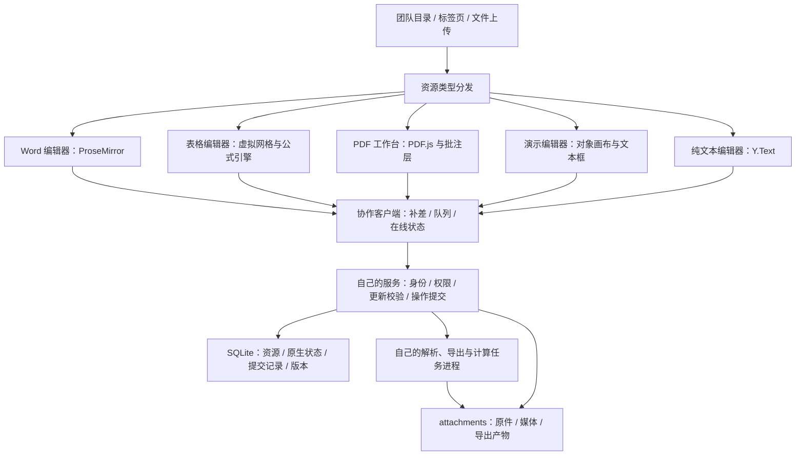

# 办公文件自主协同编辑方案

调研日期：2026-10-15。状态：设计提案，未实施。

## 1. 目标与推荐路线

在团队工作空间中上传、创建、编辑和协作处理办公文件，文件与编辑数据均保存在自己的服务中。自行实现编辑界面、文档模型、协作协议、版本管理和格式适配，不接入 ONLYOFFICE、Collabora、WPS 或 Microsoft 在线编辑服务。

这里的自主实现允许复用本地运行的基础开源库：项目已有的 Yjs、ProseMirror、PDF.js、fflate 继续使用。它们不承接托管、不接收文件；新增依赖固定版本并记录许可。若以后要求连基础库也不使用，需要另行扩大项目范围。

本次范围确定为 DOCX、XLSX、PDF、PPTX、CSV/TSV、TXT。建设文字、表格、PDF、演示和纯文本五类编辑入口，CSV/TSV 复用表格编辑器，共用文件与协作基础设施：

| 类型 | 首期编辑能力 | 协作内容 | 导出 |
| --- | --- | --- | --- |
| Word / DOCX | 段落、标题、字形、列表、图片、基础表格、链接、分页符 | 正文、评论、光标 | 支持范围内的 DOCX |
| Excel / XLSX | 多工作表、单元格、基础格式、行列操作、基础公式 | 单元格、工作表结构、选区、评论 | 支持范围内的 XLSX，另可导出 CSV |
| PDF | 阅读、高亮、批注、手绘、附加文本、基础表单填写 | 注释对象、评论、表单值 | 原文件、带批注副本、扁平化副本，分阶段实现 |
| 演示 / PPTX | 幻灯片、文本框、图片、基础形状、图层、对齐、备注和静态放映 | 文本、对象、页面顺序、选中状态和评论 | 支持范围内的 PPTX |
| 数据 / CSV、TSV | 编码与分隔符预览、单表网格、单元格和行列操作 | 复用表格的单元格与选区协作 | CSV、TSV，可另存 XLSX |
| 纯文本 / TXT | 原样文字、查找替换、编码及换行设置 | 字符级编辑、选区和光标 | TXT |

**核心决策：办公文件导入后以原生结构化模型协作；DOCX、XLSX、PDF、PPTX、CSV/TSV、TXT 是输入、输出及原件存档格式。每次按键不重写、同步整个文件。**

不将首期目标描述为“完整替代 Office”。Word 的分页排版、Excel 的公式与引用语义、PDF 的底层内容改写，分别是独立的大型工程。先交付明确兼容范围的协同编辑，再逐步扩展。

## 2. 当前仓库中可复用的基础

以下结论来自当前工作树代码；仓库已有其他未提交修改，本提案不修改这些业务文件。

| 现有实现 | 接入价值与需要补足的部分 |
| --- | --- |
| `packages/editor/blocks` 的 ProseMirror、y-prosemirror | 复用文字输入、基础表格与富文本协作；新增 Word 专用 schema，不能将 DOCX 转 Markdown 后宣称保真 |
| `packages/common/crdt` | 已封装 Yjs 和 Awareness；可以复用协作状态，增加表格选区、PDF 页面位置等类型 |
| `packages/common/nbstore/src/cloud.ts` | 已有 POST 更新、SSE 广播、状态向量补差、队列与恢复代际；首期可沿用传输方式，不必先改 WebSocket |
| `packages/frontend/apps/web/server/cloud.ts` | 已有空间权限、文档权限、删除标记、附件归属；扩展办公资源授权及按资源过滤事件 |
| `packages/frontend/core/src/workspace.ts` | 目前文档默认进入 `BlockStore` 并按笔记方式索引，需要按资源类型分发 |
| `packages/editor/blocks/src/pdf-preview.tsx`、`pdf-engine.ts` | 已有 PDF.js 本地阅读、缩放、翻页与密码输入；可演进为独立 PDF 工作台 |
| `packages/common/nbstore/server/attachment-files.ts` | 复用哈希文件、校验及原子写入，保存原件、图片与导出文件 |
| `packages/common/nbstore/server/backups.ts`、`packages/frontend/core/src/backup.ts` | 当前备份有表白名单和笔记附件遍历；新增办公模型必须显式纳入 |

需要特别处理的现状：附件接口读取返回 Base64，前后端均有 20 MB 限制；`/presence` 只接受文字光标形态；文档标识主要接受 `doc:` / `workspace:`；部分在线状态广播按空间发送。不能只增加一个文件打开按钮，就认为权限、同步和备份都已经接通。

当前权限代码已经检查部分附件归属及 `denied` 授权，强于 `docs/工作空间与协作.md` 的部分旧说明。实施时更新说明，并逐条验证资源访问，不沿用“附件只按空间授权”的旧结论。

## 3. 总体架构



数据分为四层：

1. **不可变原件**：上传字节与 SHA-256 永久对应，可随时下载原件，不被自动导出覆盖。
2. **可协作原生状态**：文字树、工作簿模型、PDF 批注、演示对象及纯文本模型，是当前编辑结果的权威来源。
3. **持久提交及版本快照**：用于重连、恢复、审计、导出和损坏排查。
4. **派生文件**：由某个确定版本生成的 DOCX、XLSX、PDF、PPTX、CSV/TSV、TXT，记录对应版本和哈希。

“保存”表示原生状态已持久化；“导出”表示该状态已成功转换为某种文件。界面分别显示“已同步”和“可下载的文件版本”，避免导出失败被误认为正文丢失。

## 4. 资源模型与目录接入

统一资源类型建议为 `note | word | spreadsheet | pdf | presentation | text | binary`。CSV/TSV 的 `kind` 为 `spreadsheet`，通过 `source_format` 区分来源，不重复建设网格模型。现有笔记保持原模型；办公资源元数据由数据库和受权限约束的 API 管理，前端将笔记列表与办公资源列表合并展示。避免初期同时维护 SQL 和工作区 Y.Map 两份可写的办公文件元数据。

办公资源使用稳定 `resourceId`，重命名、移动和编辑均不改变 ID。正文存储可继续使用 `doc:<resourceId>`，并以服务端资源类型选择解析与校验器；不要未经全链路修改直接增加 `office:` 前缀。API 校验旧笔记与办公资源 ID 不冲突。

建议新增公共结构：

| 表 | 主要字段与职责 |
| --- | --- |
| `office_resources` | `scope, workspace, id, kind, name, folder_id, original_asset_id, source_format, format_options, model_version, generation, head_seq, created_by, created_at, deleted_at`；资源与当前状态定位；`format_options` 保存经校验的初始编码、换行及分隔符配置 |
| `office_commits` | `scope, workspace, resource, generation, seq, operation_id, actor, kind, payload, created_at`；被接受的更新或操作记录 |
| `office_versions` | `scope, workspace, resource, id, generation, seq, model_version, state_asset_id, created_by, created_at`；不可变状态快照 |
| `office_artifacts` | `scope, workspace, resource, version_id, format, asset_id, status, error`；某一版本的导出结果 |
| `office_jobs` | `scope, workspace, resource, id, type, input_version, status, lease_until, attempts, error`；持久任务与崩溃重试 |

`documents` 仍保存当前 Yjs 状态，不再增加另一份“当前内容”表。状态写入、`head_seq` 推进、提交记录和幂等操作 ID 在同一短事务中完成。文件和媒体继续通过 `assets/asset_files` 保存；快照、产物引用也参与附件保留及垃圾回收计算。

可编辑的格式设置进入版本化原生模型，导出覆盖参数记录在产物任务中；`format_options` 只作为导入初始配置或同步更新的查询投影，不能成为绕过版本的第二份可写事实来源。

表主键、唯一索引及外键使用完整隔离键；例如提交唯一键 `(scope, workspace, resource, generation, seq)` 和对应的 `operation_id` 唯一索引。不能只靠一个前端传来的资源 ID 判断归属。

前端打开办公资源时不执行笔记的 `ensureNote()`、Markdown 序列化或白板初始化。首期搜索覆盖名称、类型及权限允许的元数据，后续再增加按版本提取的正文索引。文件夹移动、标签、收藏及回收站也通过统一资源适配层接入。

## 5. Word：复用文字协作，自己实现 DOCX 适配

### 5.1 原生模型与界面

使用 ProseMirror 实现 Word 专用 schema，Y.XmlFragment 保存正文，独立共享结构保存页面设置、评论和图片引用。首期支持标题、段落、列表、基本字形、缩进、链接、内嵌图片和基础表格；页面大小、页边距和手动分页符纳入模型。

编辑阶段先提供流式排版和纸张宽度视图。自动分页是派生布局，不写入 CRDT；不同客户端不能将各自测量的分页结果反复同步。复杂跨页表格、浮动图片、分栏、页眉页脚与自动目录后续逐项实现。浏览器打印首期只承诺基本输出，不能宣称与 Word 页码完全一致。

沿用文字 CRDT 合并与光标机制；评论锚点采用 Yjs 相对位置，删除被评论内容后显示“原文已删除”，而不是用容易偏移的整数位置。Yjs 官方绑定说明也建议评论采用相对位置或文档内状态。[Yjs 的 ProseMirror 绑定说明](https://github.com/yjs/docs/blob/main/ecosystem/editor-bindings/prosemirror.md)

### 5.2 DOCX 导入导出

DOCX 是 OOXML 包，解析需要处理正文 XML、样式、编号、关系和媒体，并非提取一段 HTML。OOXML 的文档表示和打包规则由 ECMA-376 定义。[ECMA-376 标准](https://ecma-international.org/publications-and-standards/standards/ecma-376/)

建议以已有 fflate 解压，在独立任务进程中自行实现受支持 XML 到原生模型的转换；导出执行反向映射，生成关系、内容类型、正文、样式和媒体。为每项支持特征建立导入、编辑、导出的样本测试。

未知 XML 不能简单拼回修改后的文档：关系 ID、段落位置及资源引用可能已经变化。保留完整原件，并产生兼容性报告；遇到无法安全编辑的内容，允许下载原件、只读查看可解析内容，或显式创建“兼容副本”。首期不直接覆盖复杂原件。

不采用“DOCX → HTML → Markdown → DOCX”作为保真链路。Mammoth 自身定位就是语义化 HTML 转换，复杂文档难以完整转换，可作辅助提取工具，不能承担完整 Word 排版适配。[Mammoth 项目说明](https://github.com/mwilliamson/mammoth.js/blob/master/README.md)

## 6. Excel：自行实现网格、公式与协作语义

### 6.1 数据模型

使用稀疏工作簿模型，不为整个 Excel 最大网格预建对象：

```text
workbook
  sheetOrder: sheetId[]
  sheets[sheetId]
    rowOrder: rowId[]
    columnOrder: columnId[]
    cells[rowId, columnId]
      input: {type, value | formulaAST}
      style: {numberFormat, font, fill, border, alignment}
      revision
    mergedRanges / dimensions / comments
```

单元格输入是原子值：不能把两人同时输入的 `100` 和 `200` 当作字符串协作拼成 `120000`。样式与输入分开更新；派生计算值不与输入互相覆盖。

行、列和工作表均有稳定 ID；A1 地址是当前顺序的显示形式。公式 AST 同时记录工作表 ID、行列 ID、相对/绝对引用规则。范围还需要边界及插入扩展策略，不能只列举当前包含的单元格 ID。删除引用得到 `#REF!`；复制填充、插入行列、跨表引用按明确规则转换。

### 6.2 协作策略

共享状态可用 Y.Map / Y.Array 表达，但服务端接收语义操作，而不是允许客户端任意覆盖工作簿。Y.Map 的嵌套共享类型可以用作基础；公式依赖、合并区域、行列约束仍需自行实现。[Y.Map 官方 API](https://docs.yjs.dev/api/shared-types/y.map)

建议首期协议：

- `setCell` 携带单元格基础 revision；不同单元格可并行提交，同一单元格发生竞争返回冲突并保留双方输入，禁止静默覆盖。
- 批量粘贴携带操作 ID，由服务端校验后一次提交；大批操作分块上传、暂存，最终原子发布，避免部分粘贴。
- 插入/删除行列、合并单元格、共享排序由服务端按资源串行校验；只读筛选及个人排序先作为个人视图。
- 客户端乐观展示放在待提交层，被拒绝的操作不能提前混入持久共享状态；收到确认后应用服务端生成的更新。
- 所有操作经过专用接口；通用 `/document POST` 对表格资源拒绝任意 Yjs 更新，避免绕过公式与结构校验。
- 首期结构操作要求在线。断线输入可作为草稿保留，重连后按 revision 逐项重放；引用目标已删除或发生竞争则进入冲突处理。

“光标已在这个单元格”是在线提示，不作为可靠锁；网络中断或浏览器关闭不能留下永久占用。

### 6.3 公式引擎

自己实现词法分析、AST、引用解析、依赖图与增量重算，禁用 `eval()`。首批函数限定为 `SUM、AVERAGE、MIN、MAX、COUNT、IF、ROUND` 和基础运算、比较及范围引用。

计算结果按 `head_seq + calculationVersion` 标记；服务器计算作为导出依据，浏览器 Worker 运行同一套计算代码提供交互反馈。明确数字精度、类型转换、日期系统、错误传播及循环依赖语义；后续扩展 NOW/RAND 等函数时必须使用统一计算上下文，不能让每个客户端自行生成不同结果。

XLSX 读写库并不自动提供计算能力。例如 SheetJS 官方明确说明其社区读写库不会自动计算公式结果。因此无论自行解析还是采用本地读写库，都要单独实现公式引擎。[SheetJS 公式文档](https://docs.sheetjs.com/docs/csf/features/formulae/)

### 6.4 XLSX 适配与性能

自行解析工作簿、工作表、共享字符串、样式、单元格类型、公式及关系。保留公式原文和原缓存值；不支持的公式标记“尚不支持计算”，不能显示为已经重算成功。导出不伪造缓存结果，明确需要在兼容软件中重新计算的范围。

网格采用行列双向虚拟化、可见区域渲染及 Worker 计算；先用 DOM 实现可编辑层，性能证据要求时再增加 Canvas 渲染，不能牺牲中文输入法、键盘导航和无障碍。

初始验收样本建议为单表 1 万行 × 20 列、10 个并发编辑者；这是压测目标，不是容量承诺。根据稀疏度、公式依赖和客户端内存测量结果调整配额。

### 6.5 CSV / TSV 接入

CSV/TSV 导入为单工作表，复用单元格模型、revision 冲突处理、行列操作和备份。导入向导展示编码、分隔符、引号、是否有表头及列类型预览；不默认将首行删除或转成不可编辑表头。

CSV 解析采用状态机，处理双引号转义、引号内分隔符、字段内换行、空字段及末尾空列，不能用 `split(',')` 或逐行切割代替。CSV 的通用格式说明见 RFC 4180；真实输入可能存在变体，因此提供预览及显式设置。[RFC 4180](https://www.rfc-editor.org/rfc/rfc4180)

TSV 明确采用制表符分隔，提供并记录“CSV 式引号转义”与“无引号转义”模式；自动判断只作建议，含歧义的引号与字段内换行由用户在预览中确认。导出选定并记录目标模式，不能假定所有 TSV 软件行为相同。

默认按文本导入，保留前导零、长编号和原始日期字符串；按列明确转换数字或日期。来自文件的 `=、+、-、@` 开头字段不自动执行公式。用户在网格中主动输入公式，按表格能力处理。

CSV/TSV 导出限定单工作表，公式默认导出该固定版本的已计算结果；未支持或未完成计算的公式列出并阻止误导性导出，允许用户显式选择导出公式文本。导出到可能执行公式的外部软件时提供“按文本转义”选项及预览；转义会改变字段内容，不得静默改变原始数据，也不能把加双引号误认为已消除公式执行风险。

原始 CSV/TSV 不能保存多工作表、样式、合并、评论及协作历史。原生模型可保留这些信息；导出显示损失清单并允许另存 XLSX。记录编码、BOM、分隔符、行尾及末尾换行策略；使用分块解析和行列配额，避免一次性复制大文本。

## 7. PDF：先做可协同的批注与表单

现有 PDF.js 已能承担本地解析、渲染；其官方定位也是 PDF 解析和渲染平台。基于现有代码增加文本层、选区及批注覆盖层。[PDF.js 官方说明](https://mozilla.github.io/pdf.js/)

每份 PDF 保留不可变原件。注释模型至少记录：`annotationId、sourceHash、pageId、type、PDF坐标、内容、作者、revision、deleted`；高亮使用多个矩形，手绘保存路径，评论保存线程。坐标使用 PDF 页面坐标并记录旋转/裁剪变换，不能保存当前缩放后的屏幕像素。

批注创建、移动、修改与删除通过服务端语义操作提交，并应用到共享状态；同一对象的竞争编辑用 revision 检测。表单值按字段 ID 同步，保存值和生成可视外观分别处理。标准 AcroForm 文本及勾选作为起点，XFA、复杂计算脚本及加密文件改写列为不支持。

PDF.js 的注释存储和 `saveDocument` 可作为标准批注导出验证的基础，但不会自动成为多人协作层；需要把自有批注模型映射为经过测试的受支持类型，不能依赖未固定版本的内部 API。[PDF.js 维护者关于批注存储与保存的说明](https://github.com/mozilla/pdf.js/issues/16146)

首期先确保原件下载、独立批注数据备份；标准批注写入和扁平化导出分别验收。扁平化指把新增批注绘入原页面，必须保留底层页面内容，不能默认将整页截图当作等价 PDF。恢复后仍需原件与批注模型才能继续编辑。

**PDF 原有文字的任意改写另立专项，不放入首期。** 增加一个文本框不等于编辑原文本；白色矩形覆盖也不等于删除敏感内容。底层内容流、字体子集、文字定位、重排与数字签名均需专门处理。pdf-lib 官方也列明不能直接编辑或移除表单之外的既有页面文字。[pdf-lib 的能力限制](https://github.com/Hopding/pdf-lib#limitations)

扫描 PDF 首期提供批注；OCR 是后续本地任务能力。数字签名与手绘签名分开定义；已签名文件保持原件只读，允许明确创建编辑副本，不承诺修改后原签名仍有效。

## 8. PPTX：自行实现演示编辑器

### 8.1 首期范围与数据模型

首期支持幻灯片新增、复制、删除与排序；文本框、内嵌图片、矩形/圆形/直线；位置、尺寸、旋转、填充、边框、图层、对齐；演讲备注、对象评论和本地静态放映。默认画幅为 16:9，导入时保留可支持的页面尺寸。

复用现有白板的交互经验和适用工具函数，但演示采用固定页面坐标、页级对象树和专用导出模型。不能将整份 PPTX 扁平化成白板图片后宣称可以编辑其中对象。

```text
presentation
  pageSize
  slideOrder: slideId[]
  slides[slideId]
    background
    elementOrder: elementId[]
    elements[elementId]
      type / transform / style / revision
      text: Y.XmlFragment（文本框或形状文字）
      assetId（图片）
    notes: Y.Text
    comments
```

页面和对象使用稳定 ID；导入关系 ID 转为内部 ID，导出重新生成合法 OOXML 关系。背景、图层、备注、评论及媒体引用都纳入版本快照；编辑区缩放和当前放映页默认属于个人视图。

### 8.2 协作与竞争处理

文本框中的文字使用现有富文本 CRDT；页面顺序、对象新增/删除/复制、图层和几何变换通过服务端语义操作提交。文本更新只允许修改已有且未删除对象的文字片段，通用文档上传不得改动受控对象结构。

对象拖动时仅广播节流后的临时预览，松手后以 `expectedRevision` 提交完整变换；同一对象的同时移动/缩放产生明确冲突，不能让 x、y、宽、高分别来自不同操作。不同对象可以并行编辑。选中提示不能作为可靠锁。

删除对象与修改文字竞争时，以服务端接受的删除结果为准，迟到更新不能复活对象；保留被拒编辑为可复制草稿。复制对象必须创建新 ID 和独立的 Yjs 文本，避免副本与原件共享同一段正文。删除幻灯片、排序、复制整页均在线串行提交并验证归属。

放映首期在本机进行；后续可增加显式“跟随演示者”模式，使用带租约的演示者权限与临时页码事件，不将放映切页写成文档修改。

### 8.3 PPTX 导入导出与兼容范围

PPTX 需要解析 PresentationML 的演示、页面、版式、母版、主题及关系，不能只读取每页文字。微软官方结构说明列明了这些主要组成部分。[PresentationML 文档结构](https://learn.microsoft.com/en-us/office/open-xml/presentation/structure-of-a-presentationml-document)

自有格式适配器首期支持基础文字、图片和形状，解析可支持的母版/版式继承并将最终静态样式落实到页级对象。复杂母版编辑、动画、切换效果、音视频、SmartArt、图表、嵌入对象及旧 `.ppt` 不在首期编辑范围；导入逐项报告未支持内容。不能承诺未解析对象仍能准确预览。

导出从固定快照生成 PPTX，包含最小必要的母版、版式、主题、页面、文字、媒体、备注及关系；页面顺序和对象层级与模型一致。自有评论首期保留在原生数据及备份中，若暂未实现 PPTX 评论写回，必须列入导出损失清单。

文字字体、换行及行高使用统一布局规则和可部署字体集；缺失字体时明确替代。验证实际 PowerPoint/LibreOffice 打开与本地放映效果，复杂样本只允许创建兼容副本，不自动覆盖原件。动画与高级排版不纳入静态首版的工期承诺。

## 9. TXT：原样纯文本协作

TXT 独立为 `text` 资源，以 Y.Text 保存字符序列；不通过 Markdown 解析、富文本转换或 HTML 清洗，保留空格、制表符、空行、末尾换行及字面标签。默认使用简单纯文本编辑区，具备中文输入、查找替换、撤销、行号和协作选区。

首期支持 UTF-8（含/不含 BOM）、UTF-16LE/BE；按 BOM 优先识别，其余使用严格 UTF-8 校验并提供预览。Unicode 官方说明 BOM 可作为编码签名，但无 BOM 不能证明不是 Unicode。[Unicode 编码与 BOM FAQ](https://www.unicode.org/faq/utf_bom.html)

无法确定的编码必须让用户明确选择，不能以替换字符吞掉乱码后直接保存。GB18030/GBK 兼容作为本地编码适配项，在编解码及往返样本验证后启用；未支持时原件可下载，不假称已经正确导入。

换行采用明确策略：单一 LF/CRLF/CR 输入可内部统一为 LF，并记录原换行类型供导出恢复；混合换行先显示预览并确认规范化策略后创建可编辑副本，不静默抹去差异。原件始终保留。编码、BOM 和换行设置也受资源授权控制并随状态版本保存。

导出默认使用记录的可支持编码和换行，可显式选择 UTF-8；目标编码无法表示新增字符时阻止有损导出，允许另存 UTF-8。TXT 不执行公式、HTML、脚本或宏，不因后缀变化自动切换为可执行内容。

同一文本的多人编辑通过 Y.Text 合并，光标使用相对位置；中文组合输入、emoji、组合字符、跨行删除及整段粘贴单独验证。撤销只针对本人的编辑；首期按文件大小及字符数限额，不预先承诺百万行编辑性能。

## 10. 通用协作、保存与安全边界

### 10.1 传输与持久化

先复用 POST + SSE + 状态向量补差，增加统一资源路由与按资源过滤。Yjs 更新具有可交换、可合并和幂等的特性，适合作为状态同步基础；业务提交序号仍单独维护，不能把状态向量直接当作线性版本号。[Yjs 更新 API](https://docs.yjs.dev/api/document-updates)

Word 和 TXT 允许经过服务端隔离校验的 Yjs 更新；表格、PDF 和演示对象结构使用上述语义操作，由服务端生成共享更新；演示文本更新另按目标对象校验。每个请求绑定空间、资源、账号、generation 和 operationId；重复提交返回原确认结果。

服务端先把更新应用到临时副本，校验模型类型、数量、体积、引用和允许修改的根结构，再执行持久事务并广播。拒绝非法更新时不污染当前文档；客户端保留草稿并从已确认状态重建。对允许离线编辑的文字资源还需要处理“离线期间删文档/恢复版本/模型升级”的情况。

服务器确认必须晚于事务提交；进程在提交后、广播前崩溃，客户端通过重连补差及操作 ID 确认恢复。持久更新、原生快照及压缩策略分别测试，明确断电持久性所采用的 SQLite journal/synchronous 配置。

### 10.2 权限与在线状态

复用所有者、管理员、成员、查看者和资源级授权；读取原件、状态、媒体、版本、产物、搜索结果及在线状态均按同一权限检查。服务端广播不能向同空间但无资源权限的成员泄露内容、文件名和人员位置。

Presence 扩展为带类型的数据：Word/TXT 相对光标、表格 sheet/row/column 选区、PDF 页面位置、演示 slide/element 选中与文本框内光标；设置体积和频率限制，用户名由服务端会话确定。在线状态和拖动预览不纳入业务备份。

撤销授权后关闭对应订阅，拒绝新的操作，并在读取请求体后再次检查权限。客户端已经合法读取的文件和内容无法通过服务端撤回，界面禁用下载也不能改变这个事实。

### 10.3 版本、撤销与导出

用户撤销只撤销自己的适用操作，不回退别人的提交。文字复用适用的 Yjs UndoManager；表格、PDF 及演示结构使用带 revision 校验的反向业务操作，遇到他人后续修改时提示冲突。

创建命名版本时固定原生状态快照与媒体引用。导出任务只读取固定快照，不从持续变化的在线文档取数据；生成成功后登记对应 `version_id`。期间即使有人继续编辑，导出结果仍只代表该版本。

恢复旧版本提升 generation，保留历史分支；旧代际队列拒绝自动写入，允许导出草稿。替换原件、重新解析及 PDF 页面重排也需要显式代际/页面映射，不能将旧批注按页码直接套到新文件。

### 10.4 文件处理

原件、导出与解析都在自己的基础设施上运行；解析进程限制内存、CPU、运行时间和文件访问，默认无外网。校验 ZIP 条目数量、展开大小、路径与 XML 深度；禁止 DTD/外部实体、宏执行和外部链接自动拉取。

首期沿用 20 MB 原件上限，并增加解压大小、页数、工作表、非空单元格、公式复杂度、幻灯片/对象数量及纯文本字符数配额。后续提升上限时同时修改上传、流式下载、桌面代理和备份校验，不能只改一个常量。增加二进制流及 Range 读取接口，避免办公大文件经 Base64 重复占用内存。

## 11. 数据库迁移与备份契约

严格遵守根目录 `AGENTS.md` 和 `docs/数据库迁移.md`。

当前公共版本是 4，协作版本是 7。若实施时仍为这两个版本，则追加公共版本 5 和需要的协作版本 8；若其他工作已推进版本，使用届时的下一版本，不占用或改写历史迁移。公共层增加办公模型所需表；团队专用授权、审计变更放在协作迁移，若没有协作结构变化则无需人为升协作版本。

同步更新 `SCHEMA_COLUMNS`、幂等 `SCHEMA_CREATE_SQL` 及协作启动列检查；仍经 `SQLiteProjectDatabase` 打开，协作入口在同一启动写事务调用 `upgradeCloudDatabase`。DDL、必要回填和版本推进一并提交；失败回滚、关闭数据库并停止启动，拒绝高版本库。

历史附件不在启动时批量转换成办公模型：保持原件和现有笔记可用，用户通过“创建可协作副本”触发解析任务。结构迁移只创建必要结构和安全回填，解析复杂文件不占用启动事务。

备份必须同时设计：

- 工作区导出增加新的有版本契约的办公资源、状态快照、原件、媒体和可选历史清单；保留旧 v1 笔记备份读取能力。
- 演示必须包含页面顺序、对象、文字、备注、评论及图片；CSV/TSV 包含列类型与分隔配置；TXT 包含原生字符、编码/BOM/换行设置，不能只备份屏幕预览。
- 业务备份表白名单显式纳入办公表，并校验引用闭合；不能只复制 `documents` 与 `assets`，也不能只备份最后一次导出的文件。
- 持久导出任务在恢复后重置为可重试，不恢复进程租约；在线状态、运行句柄和临时文件不作为业务数据。
- 跨空间恢复重建资源 ID、附件归属、公式跨表引用、演示页/对象引用及评论关联；不从备份自动继承原空间成员权限。
- 整库快照继续确保附件自包含；手工复制运行库仍须停服务并复制数据库与附件目录。
- 文件写入与 SQLite 不能形成跨文件系统原子事务：先写临时文件、校验和原子重命名，再短事务写索引；失败产生的无引用文件延迟回收，不能提前删除旧件。

## 12. 建议代码划分与接口

以下都是建议新增模块，不表示已经存在：

```text
packages/common/office-model/       类型、版本、语义操作与模型校验
packages/common/office-format/      DOCX/XLSX/PPTX 解析及导出
                                  CSV/TSV 状态机、TXT 编解码与换行适配
packages/common/spreadsheet-calc/   公式 AST、引用和增量计算
packages/editor/word/              Word schema、工具栏和页面视图
packages/editor/spreadsheet/       网格、输入、公式栏和选区
packages/editor/pdf/               阅读、批注、表单与坐标映射
packages/editor/presentation/      固定画幅、对象交互、文本框与放映
packages/editor/text/              Y.Text 绑定、纯文本输入及编码设置
packages/frontend/apps/web/server/office/
                                  资源、提交、授权、版本及任务服务
```

服务接口可先采用 `/api/cloud/office-*?workspace=...&id=...` 的平面命名，降低现有桌面代理路径匹配的改造范围；无论路径形式如何，都需同步验证代理、方法、响应头、上传大小和超时。

建议最小接口集合：上传/创建、资源列表与元数据、原件流式读取、模型加载与补差、语义操作提交、Presence、版本创建/读取/恢复、导出任务创建/查询/下载。媒体必须使用资源绑定，不开放哈希路径直读。

本地个人工作区可以先提供原件管理与阅读，团队空间优先实现协作。后续本地编辑使用同一模型和本地存储适配器，不能承诺 Web 端在整台服务断网后已有可靠离线持久化；须以实际存储能力为准。

## 13. 分期与交付估算

以下是工程估算，假设 2 名有编辑器经验的全职开发配合测试，且复用现有基础库；不是已验证工期。表中单位为该配置下的日历周，独立开发需重新估算，不能直接视为人周。复杂样本比例会显著影响结果。

| 阶段 | 可验收交付 | 预计时间 |
| --- | --- | --- |
| P0：格式与协作验证 | 六组格式样本与模型契约；DOCX 协作、XLSX 引用、PDF 批注导出、PPTX 对象往返及 CSV/TXT 编码验证 | 1–2 周 |
| P1：公共资源底座 | 文件目录、原件管理、类型分发、权限、提交、版本、任务、迁移与备份 | 2–3 周 |
| P1a：TXT 首版 | 纯文本协作、UTF 编解码、换行、原件保留及往返导出 | 1–2 周 |
| P2：Word 首版 | 支持范围内 DOCX 导入/编辑/导出、双人协作、评论、兼容报告 | 3–5 周 |
| P3：PDF 首版 | 阅读、批注、基础表单协作；批注导出与扁平化按验证结果交付 | 2–4 周 |
| P4：表格与 CSV/TSV 首版 | 网格、稳定行列、基础公式、竞争处理、XLSX 往返、CSV/TSV 预览及导入导出 | 7–11 周 |
| P5：PPTX 首版 | 页面与对象、文本协作、冲突处理、基础样式继承、备注、静态放映及 PPTX 往返 | 6–10 周 |
| P6：整体验收 | 故障恢复、权限、格式回归、压测及 Web/桌面发布验证 | 2–3 周 |

补齐后的顺序推进估算约 24–40 周；阶段之间存在复用空间，具体排期在 P0 结束后收敛。先以 TXT 验证资源底座与完整协作链路，再交付基础 Word、PDF、Excel/CSV/TSV，最后完成 PPTX。完整 Office 格式兼容、精确分页、复杂公式、演示动画及任意 PDF 原文修改不在此估算范围内。

## 14. 上线验收标准

1. **格式往返**：受支持 DOCX 的内容、图片、列表与表格经导入编辑导出后可重开；XLSX 数据、日期、格式和公式样本正确；PDF 不同缩放、旋转、裁剪下批注定位一致。
2. **兼容性告知**：不支持的图表、修订、宏、复杂公式等有报告；保留原件，不静默删除后冒充保真保存。
3. **并发**：文字同时编辑及删除评论锚点；表格不同单元格并行、同格竞争、插入行同时改公式；PDF 修改与删除同一注释，均有确定结果或明确冲突。
4. **重连**：重复、乱序更新、提交成功但响应丢失、SSE 丢消息、断线、重启、版本恢复后旧队列均不造成重复提交或覆盖新代际。
5. **权限**：直接调用 API、伪造模型更新、猜原件/媒体/版本 URL、撤权后提交、跨空间引用、无权限 SSE 订阅均被拒绝。
6. **保存**：提交后重启仍有内容；导出固定版本；磁盘写满、任务超时、解析失败和导出失败不损坏原件与已确认状态。
7. **迁移与备份**：旧库升级、数据保留、重复启动、失败回滚、高版本拒绝；新旧工作区备份兼容，原件与媒体哈希一致。
8. **性能**：在注明服务器、客户端与网络条件下验证 10 人协作、表格样本及大 PDF；记录交互延迟、同步延迟和内存，再决定正式容量。
9. **PPTX**：双人同时编辑不同对象及同一文本框；拖动竞争、对象删除与文字更新竞争、页面排序和复制均不丢数据或复活已删除内容；导出可重开，图片、备注和页面尺寸正确；不支持的动画/母版和评论写回有报告。
10. **CSV/TSV**：引号内分隔符/换行、双引号转义、空列、末尾空字段、TSV 两种转义模式、前导零、长编号、非 UTF-8 编码选择及公式样式字符串均按预览处理；只导出选定工作表，明确样式/评论损失和公式结果来源。
11. **TXT**：UTF-8 BOM、UTF-16 字节序、LF/CRLF/CR、混合换行确认、空文件、末尾换行、制表符、中文输入法、emoji 及组合字符可往返；编码不明和不可表示字符不会被静默替换。

首个开发批次建议锁定 P0：先用真实 DOCX/XLSX/PDF/PPTX/CSV/TSV/TXT 样本证明数据模型、同步及导出路径可行，再建设生产入口。尤其必须先验证表格引用、PDF 导出及 PPTX 对象往返，避免界面完成后才发现底层模型无法可靠保存。
